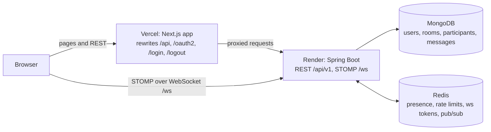
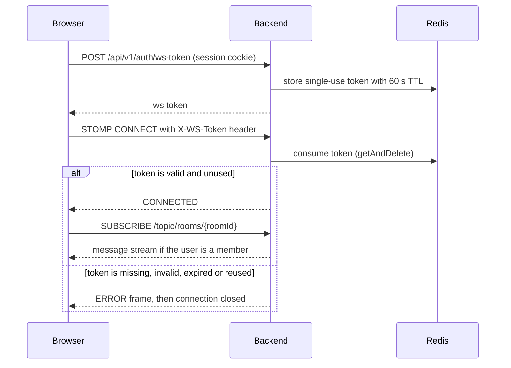

# ChatMee

[](https://github.com/N-Tien-L/ChatMee/actions/workflows/backend-ci.yml)
[](https://github.com/N-Tien-L/ChatMee/actions/workflows/frontend-ci.yml)
[](https://chat-mee-wine.vercel.app/)
<!-- TODO(owner): coverage badge -->

ChatMee is a real-time chat application. Users sign in with Google or GitHub OAuth2, create group rooms or direct messages, and exchange messages over STOMP on a WebSocket, with presence and typing indicators. A Spring Boot backend stores rooms and messages in MongoDB and uses Redis for presence, rate limiting and cross-instance events. A Next.js frontend is deployed on Vercel.

**Live Demo:** [https://chat-mee-wine.vercel.app/](https://chat-mee-wine.vercel.app/)

<!-- SCREENSHOT(owner): docs/images/login.png - the sign-in page with Google and GitHub buttons -->
<!-- SCREENSHOT(owner): docs/images/room-list.png - the dashboard with the list of the user's rooms -->
<!-- SCREENSHOT(owner): docs/images/chat-room.png - a room with messages and a typing indicator -->
<!-- SCREENSHOT(owner): docs/images/discover-rooms.png - the public room discovery view -->
<!-- SCREENSHOT(owner): docs/images/presence.png - the member list with online presence dots -->

## Features

Implemented features, taken from the specs in [`docs/specs/`](docs/specs/):

- **Sign-in with OAuth2**: Google and GitHub login; users are matched by provider and provider id. `GET /api/v1/auth/me` returns the signed-in profile. ([SPEC-001](docs/specs/SPEC-001-auth-oauth2.md))
- **Group rooms**: create a `PUBLIC` or `PRIVATE` room with a name, description and member limit; the creator becomes `OWNER`. Users see only the rooms they belong to. ([SPEC-002](docs/specs/SPEC-002-chat-rooms.md))
- **Joining and membership roles**: members join public rooms while seats are free; `OWNER` and `ADMIN` add members to private rooms; only `OWNER` grants `ADMIN`. Membership changes are atomic, so a room never exceeds its member limit. ([SPEC-002](docs/specs/SPEC-002-chat-rooms.md), [ADR-0005](docs/adr/0005-room-membership-consistency-without-transactions.md))
- **Room deletion**: the owner soft-deletes a room; members lose access and receive a room-deleted message. ([SPEC-002](docs/specs/SPEC-002-chat-rooms.md))
- **Leaving and revocation**: a member who leaves, or a room that is deleted, stops receiving that room's frames at once, including on subscriptions that were already open. The owner cannot leave their own room. ([SPEC-002](docs/specs/SPEC-002-chat-rooms.md), [websocket protocol](docs/design/websocket-protocol.md))
- **Public room discovery**: `GET /api/v1/rooms/discover` returns paged public rooms the caller has not joined. ([SPEC-002](docs/specs/SPEC-002-chat-rooms.md))
- **Direct messages**: a two-person room that shows the other person's name. Each pair of users has one direct message, and starting it again returns the existing room. The room list includes the other member as `counterpart`. A direct message cannot be joined, extended, given another member limit, or left. ([SPEC-003](docs/specs/SPEC-003-direct-messages.md))
- **Real-time messaging**: messages are saved before they are broadcast to `/topic/rooms/{roomId}`. Failures are reported privately to the sender. ([SPEC-004](docs/specs/SPEC-004-messaging-realtime.md))
- **Message history**: the latest 50 messages of a room are loaded ([SPEC-004](docs/specs/SPEC-004-messaging-realtime.md))
- **Failed messages**: a failed message offers Resend and Discard. ([SPEC-004](docs/specs/SPEC-004-messaging-realtime.md))
- **Reconnect and resync**: the client reconnects with backoff, re-subscribes, and refetches the latest history page. Switching rooms drops the previous room's subscriptions. ([SPEC-004](docs/specs/SPEC-004-messaging-realtime.md), [websocket protocol](docs/design/websocket-protocol.md))
- **Presence**: a user is online while any authenticated STOMP session exists on any backend instance, with a 10 s grace period after the last session closes. ([SPEC-005](docs/specs/SPEC-005-presence-typing.md), [ADR-0002](docs/adr/0002-redis-for-presence-and-rate-limit.md))
- **Typing indicators**: members of a room see who is typing; events are throttled per user. ([SPEC-005](docs/specs/SPEC-005-presence-typing.md))
- **User search**: paged search by name that returns no email addresses and excludes the caller. ([SPEC-006](docs/specs/SPEC-006-user-discovery.md))
- **Rate limiting**: REST and STOMP limits described in the [security model](#security-model). ([SPEC-007](docs/specs/SPEC-007-rate-limiting.md))

### Roadmap

Planned work, taken from the specs (ticket IDs refer to [`docs/plan/`](docs/plan/)):

- Cursor-based message history with `before` and `nextCursor` (CM-044, [SPEC-004](docs/specs/SPEC-004-messaging-realtime.md)).
- Presence visible only to users who share a room (open question, [SPEC-005](docs/specs/SPEC-005-presence-typing.md)).

Not planned for the current phase: attachments, message edits, reactions, read receipts, ownership transfer, bans and moderation ([SPEC-002](docs/specs/SPEC-002-chat-rooms.md), [SPEC-004](docs/specs/SPEC-004-messaging-realtime.md)).

## Architecture

The browser loads the Next.js app from Vercel. Vercel rewrites `/api`, `/oauth2`, `/login` and `/logout` to the Spring Boot backend on Render. The browser opens its STOMP connection to `/ws` on the backend directly, because Vercel does not proxy WebSockets ([websocket protocol](docs/design/websocket-protocol.md)).



The WebSocket authentication flow uses a single-use token, as described in [ADR-0004](docs/adr/0004-websocket-authentication-token.md) and [the websocket protocol](docs/design/websocket-protocol.md):



## Design Decisions

- [ADR-0001](docs/adr/0001-mongodb-as-primary-store.md): MongoDB is the primary store, with unique indexes and atomic updates for integrity.
- [ADR-0002](docs/adr/0002-redis-for-presence-and-rate-limit.md): Redis holds presence sessions and rate-limit counters, and fans out presence events between instances.
- [ADR-0003](docs/adr/0003-stomp-over-websocket.md): real-time traffic uses STOMP over a plain WebSocket, without SockJS.
- [ADR-0004](docs/adr/0004-websocket-authentication-token.md): WebSocket connections authenticate with a short-lived, single-use token.
- [ADR-0005](docs/adr/0005-room-membership-consistency-without-transactions.md): room membership stays consistent with conditional atomic updates instead of multi-document transactions.

## Security Model

- **Sign-in**: OAuth2 login with Google or GitHub. Users are matched only by `(provider, providerId)`; accounts are never linked by email ([SPEC-001](docs/specs/SPEC-001-auth-oauth2.md)).
- **Session**: the session cookie is `HttpOnly`, `SameSite=Lax`, and `Secure` in production. CSRF protection is enabled for state-changing requests, and `POST /logout` destroys the session ([SPEC-001](docs/specs/SPEC-001-auth-oauth2.md)).
- **API errors**: `/api/**` returns 401 or 403 as `application/problem+json` without redirects ([error handling](docs/design/error-handling.md)).
- **Identity**: the caller comes from the session principal or the STOMP principal, never from a request body or payload ([SPEC-001](docs/specs/SPEC-001-auth-oauth2.md), [SPEC-004](docs/specs/SPEC-004-messaging-realtime.md)).
- **WebSocket handshake**: only the configured client origin is accepted; a foreign `Origin` gets 403 ([websocket protocol](docs/design/websocket-protocol.md)).
- **WebSocket CONNECT**: requires a single-use token from `POST /api/v1/auth/ws-token`. Tokens expire after 60 seconds and are consumed atomically. Missing, invalid, expired or reused tokens get an ERROR frame and the connection is closed ([ADR-0004](docs/adr/0004-websocket-authentication-token.md)).
- **WebSocket authorization**: SUBSCRIBE and SEND go through destination allowlists. Room topics require membership, and direct sends to `/topic`, `/queue` or `/user` are denied. Application errors go only to the sender's user queue ([websocket protocol](docs/design/websocket-protocol.md)).
- **Rate limits**: anonymous REST callers get 20 requests per minute per address and signed-in users 100 per minute. Chat messages are limited to 10 per 5 s per user, typing to 10 per 5 s, and presence reports to 20 per 60 s. Over-limit REST calls return 429 with `Retry-After`. Redis failures fail open ([SPEC-007](docs/specs/SPEC-007-rate-limiting.md)).
- **Logs**: logs do not contain session IDs, email addresses, raw OAuth attributes or message content ([SPEC-001](docs/specs/SPEC-001-auth-oauth2.md), [SPEC-004](docs/specs/SPEC-004-messaging-realtime.md)).
- **Subscription revocation**: each room frame is delivered only after membership is checked again in the database, so a member who leaves or a deleted room stops receiving frames on open sessions. Frames already accepted by the WebSocket transport cannot be recalled ([websocket protocol](docs/design/websocket-protocol.md)).
- **Known gap**: online presence is visible to every signed-in user (see [Roadmap](#roadmap)).

## Testing

Backend tests follow the naming in [AGENTS.md](AGENTS.md): `*Test` for unit tests (Mockito), `*WebMvcTest` for controller slices, and `*IT` for integration tests with Testcontainers. Test methods are named `method_condition_expectedResult`. Frontend tests use Vitest.

The done gate for a change is:

```bash
# backend (requires Docker for Testcontainers)
cd backend
./mvnw verify

# frontend
cd frontend
npm run lint && npx tsc --noEmit && npm test && npm run build
```

## Getting Started

### Prerequisites

- Java 17
- Node.js and npm
- Docker (for MongoDB and Redis)
- An OAuth2 client for Google or GitHub

### Run Locally

1. Start MongoDB and Redis:

   ```bash
   docker compose up -d
   ```

2. Start the backend with the `local` profile. Copy the example environment file and fill in your OAuth client values in `backend/.env`; never commit that file.

   ```bash
   cp backend/.env.example backend/.env
   cd backend
   ./mvnw spring-boot:run -Dspring-boot.run.profiles=local
   ```

3. Start the frontend on [http://localhost:3000](http://localhost:3000). It proxies requests to the backend on port 8080.

   ```bash
   cp frontend/.env.example frontend/.env.local
   cd frontend
   npm ci
   npm run dev
   ```

With the `dev` or `local` profile, the backend serves the OpenAPI document at `/v3/api-docs`. It is disabled in the `prod` profile ([SPEC-001](docs/specs/SPEC-001-auth-oauth2.md)).

## Project Workflow

Changes follow the workflow in [AGENTS.md](AGENTS.md):

1. **Spec**: write or update a spec in [`docs/specs/`](docs/specs/). Coding starts only after the spec is `Approved`.
2. **Design**: update [`docs/design/`](docs/design/) for changes to data models, WebSocket protocol, authorization or architecture. Record architectural choices in [`docs/adr/`](docs/adr/).
3. **Plan**: split the work into `CM-xxx` tickets in [`docs/plan/`](docs/plan/).
4. **Code**: work on a `feat/CM-xxx-short-name` branch. Write a failing test before fixing a bug.
5. **Test**: cover each acceptance criterion with at least one test and run the done gate.

Commits follow Conventional Commits with a `Refs: CM-xxx` footer.

## What I Learned

<!-- TODO(owner): personal section -->

## Repository Layout

```text
.
├── backend/                 # Spring Boot 3.5 API (Java 17)
│   └── src/main/java/com/lnt/chatmee/
│       ├── config/          # Spring configuration (security, WebSocket, Redis, Mongo, OpenAPI)
│       ├── controller/      # Controllers
│       ├── dto/             # Request and response DTOs
│       ├── exception/       # Exception types
│       ├── model/           # MongoDB documents
│       ├── repository/      # Spring Data repositories
│       ├── security/        # Security components
│       ├── service/         # Use cases
│       └── util/            # Utilities
├── frontend/                # Next.js 15 App Router, React 19, TypeScript
│   ├── app/                 # Routes
│   ├── components/          # Pure UI components (components/ui is shadcn code)
│   ├── lib/api/             # HTTP client, one file per resource
│   ├── lib/realtime/        # STOMP client
│   ├── lib/stores/          # Zustand stores
│   └── lib/types/           # Shared types
└── docs/                    # Specs, design, ADRs, plan and audit documents
```

The frontend layout is the module boundary listed in [AGENTS.md](AGENTS.md).

## License

See the [LICENSE](LICENSE) file for details.
