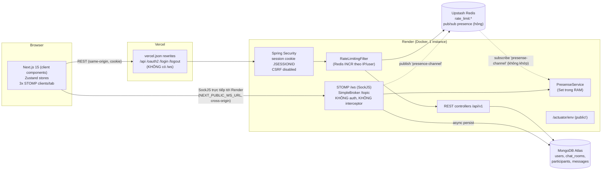

# ChatMee: Báo cáo audit

> Ngày audit: 2026-10-08 · Commit: `e425bc2` (nhánh `main`) · Phạm vi: toàn bộ repo (backend, frontend, cấu hình deploy, tài liệu, lịch sử git)
> Phương pháp: đọc toàn bộ mã nguồn, chạy `mvnw verify`, `npm ci`, `npm run lint`, `tsc --noEmit`, `npm run build`, `npm audit`. Chạy thật backend ở local (MongoDB 7 + Redis 7 trong Docker tạm, OAuth dùng giá trị giả) để thử các lỗ hổng bằng `curl` và một script STOMP tự viết.
> Quy ước: `file:line` tính từ thư mục gốc repo. Những chỗ ghi **"chưa xác minh"** là suy luận từ code hoặc cấu hình, chưa được chứng minh bằng thực nghiệm.

---

## ⚠️ 0. Cảnh báo bảo mật (đọc trước)

### 0.1 Secret trong lịch sử git: KHÔNG phát hiện
- Đã quét toàn bộ `git log --all -p` theo các mẫu `client-secret`, `CLIENT_SECRET`, `password`, `mongodb(+srv)://user:pass@`, `GOCSPX-`, `ghp_`, `redis://`.
- Mọi kết quả khớp đều là placeholder (`your-google-client-secret`, `<cluster>`, `${GOOGLE_CLIENT_SECRET}`…).
- Các file `backend/.env.dev`, `backend/.env.prod`, `frontend/.env` đang có trên máy nhưng **chưa từng được commit**: chúng không có trong `git ls-files` và không xuất hiện trong lịch sử thêm file. Audit không in nội dung của các file này.

### 0.2 🔴 CRITICAL: `/actuator/env` công khai và trả về toàn bộ secret dạng plaintext
- `backend/src/main/resources/application.properties:5-6` mở endpoint `env` và đặt `management.endpoint.env.show-values=always`.
- `backend/src/main/java/com/lnt/chatmee/config/SecurityConfig.java:37` cho phép mọi người truy cập `/actuator/**` mà không cần đăng nhập (`permitAll()`).
- **Đã xác minh ở local:** gọi `curl http://localhost:8089/actuator/env` không kèm cookie thì nhận `200`. Response chứa nguyên giá trị `GOOGLE_CLIENT_SECRET` (giá trị giả đã dùng khi test) và Mongo URI.
- `application.properties` là cấu hình gốc, dùng chung cho mọi profile, nên production trên Render nhiều khả năng cũng đang lộ `GOOGLE_CLIENT_SECRET`, `GITHUB_CLIENT_SECRET`, `MONGO_URI_PROD` (kèm user và mật khẩu) và `REDIS_URL` tại `https://chatmee-wxvk.onrender.com/actuator/env`. **Điểm này chưa xác minh trên prod.** Audit cố ý không gọi vào hệ thống production.
- **Việc cần làm ngay, trước mọi việc khác:**
  1. Tắt endpoint `env`: chỉ để `exposure.include=health,info` và bỏ `show-values`.
  2. **Rotate toàn bộ secret** trên Render: Google/GitHub OAuth client secret, mật khẩu user MongoDB Atlas, mật khẩu Upstash Redis.
  3. Xem log truy cập Atlas/Upstash để tìm kết nối lạ.
- README còn quảng cáo endpoint này ở `README.md:125`: "Actuator endpoints (`/actuator/env`, …) are exposed".

---

## 1. Tóm tắt điều hành: 10 vấn đề quan trọng nhất

| # | Mức độ | Vấn đề | Bằng chứng | Công sức |
|---|---|---|---|---|
| 1 | Critical | `/actuator/env` công khai, lộ secret dạng plaintext | §0.2, đã xác minh ở local | S |
| 2 | Critical | WebSocket/STOMP **không xác thực**. Server tin `senderId` do client gửi lên, nên bất kỳ ai, kể cả người chưa đăng nhập, cũng có thể **giả danh user khác** để gửi tin, và tin giả được lưu vào DB | `ChatWebSocketController.java:44-58`, `SecurityConfig.java:37` (`/ws/**` permitAll). Đã xác minh: tin giả được lưu với `senderId=user-victim` | M |
| 3 | Critical | Không kiểm tra quyền khi SUBSCRIBE: ai cũng **đọc được tin realtime của mọi phòng**, kể cả phòng PRIVATE và DM, chỉ cần biết `roomId` | `WebSocketConfig.java:31-36` không có `ChannelInterceptor`. Đã xác minh | M |
| 4 | Critical | Next.js 15.5.2 dính CVE nghiêm trọng (RCE trong React flight protocol, lộ source của Server Actions, DoS). Frontend đang chạy production trên Vercel | `frontend/package.json` (`"next": "15.5.2"`), `npm audit`: 2 critical, 6 high | S |
| 5 | High | Presence và typing **giả mạo được** cho bất kỳ user nào, qua STOMP và qua REST `POST /api/v1/presence/offline` | `PresenceWebSocketController.java:25-37`, `PresenseController.java:35-47`, `TypingController.java:18-22`. Đã xác minh | S |
| 6 | High | Luồng Redis Pub/Sub cho presence **không hoạt động**: publisher và subscriber dùng hai tên channel khác nhau, còn listener thì ném NPE ở mọi lần connect và disconnect | `RedisPresencePublisher.java:13` (`presence-channel`) và `RedisConfig.java:15` (`presense-channel`). `redis-cli PUBSUB CHANNELS` chỉ trả về `presense-channel`. NPE tại `PresenceEventListener.java:25,34` | S |
| 7 | High | Validation **không chạy**: DTO dùng `javax.validation` trên Spring Boot 3 (Jakarta) và thiếu `spring-boot-starter-validation`, nên mọi `@NotBlank`, `@Size`, `@Max` bị bỏ qua | `pom.xml:89-93`, `dto/request/*.java:3-8` | S |
| 8 | High | `@Transactional` không có tác dụng (không có `TransactionManager`). Dữ liệu thành viên phòng lưu ở hai nơi (`ChatRoom.participants` và collection `participants`), cập nhật không nguyên tử và có race condition. Unique index cũng **không được tạo** | `ChatRoomService.java:205,240,251,296`, `ParticipantService.java:68,84`, `ChatRoom.java:38`. Đã xác minh: collection `participants` chỉ có index `_id_` | M |
| 9 | High | Join phòng PRIVATE không cần lời mời: `POST /chatrooms/{id}/join` không kiểm tra loại phòng | `ParticipantService.java:69-82`, `ChatRoomController.java:124-140` | S |
| 10 | High | Frontend: đổi phòng thì **tin của phòng cũ hiện lẫn vào phòng mới**; sau khi tự reconnect thì **không nhận tin nữa**; mỗi tab mở 3 kết nối STOMP | `useRoomMessage.ts:95` gọi `unsubscribe(roomId)` sai key; `useWebSocket.ts:133` và `:74-78`; `useWebSocket()` được gọi ở 3 nơi | M |

Các vấn đề quan trọng tiếp theo: test gần như bằng 0 (test duy nhất cũng fail); `npm run lint` fail; không có CI; Spring không tự đọc file `.env` nên không có cách chạy bằng một lệnh; README và `backend/README.md` mô tả sai so với code (header rate limit, format response, Redis…).

---

## 2. Hiện trạng

### 2.1 Kết quả build, test và lint

| Lệnh | Kết quả | Ghi chú |
|---|---|---|
| `backend: ./mvnw -B verify` | ❌ **BUILD FAILURE** | Compile pass (59 file main, 4 file test). `ChatmeeApplicationTests.contextLoads` lỗi `IllegalArgumentException: The connection string is invalid` vì `${MONGO_URI_DEV}` không được set. Spring Boot không tự đọc `backend/.env.dev`. Test cần MongoDB và Redis thật, chưa có Testcontainers hay profile test |
| `backend: ./mvnw -DskipTests package` | ✅ | Tạo ra `target/chatmee-0.0.1-SNAPSHOT.jar` |
| Chạy jar ở local (profile dev, Mongo/Redis qua Docker, OAuth giả) | ✅ khởi động được sau 9,7 giây | Có NPE trong log ở mọi lần STOMP connect và disconnect (§3, C-6) |
| Số test backend | 1 test (`contextLoads`), đang fail | `CorsConfigTest.java`, `WebSocketConfigTest.java`, `ChatRoomControllerTest.java` đều 0 byte |
| `frontend: npm ci` | ✅ | 491 package. `npm audit` (cả dev): **27 lỗ hổng (3 critical, 21 high, 3 moderate)** |
| `frontend: npm audit --omit=dev` | ⚠️ 9 lỗ hổng (2 critical, 6 high, 1 moderate) | `next` (critical, dependency trực tiếp), `websocket-driver` (critical, qua sockjs), `axios` (high, trực tiếp), `postcss`, `sharp`, `form-data`, `nanoid`, `source-map-js`, `follow-redirects` |
| `frontend: npm run lint` | ❌ **exit 1: 2 error, 23 warning** | Error 1: `hooks/useRoomMessage.ts:56` dùng `any`. Error 2: `tailwind.config.ts:85` dùng `require()` |
| `frontend: npx tsc --noEmit` | ✅ exit 0 | `strict: true` đã bật (`tsconfig.json`) |
| `frontend: npm run build` | ✅ | `next build` chỉ lint `app/`, `components/`, `lib/`, nên không bắt được 2 error nằm ở `hooks/` và `tailwind.config.ts` |
| `docker compose` | ⛔ không có | Repo không có file compose nào |
| CI | ⛔ không có | `.github/workflows/backend-ci.yml` và `frontend-ci.yml` đều 0 byte và **chưa được track** (`git status`: `?? .github/`) |

**Muốn chạy được local hiện tại cần:** MongoDB và Redis (chưa có compose), OAuth client Google/GitHub (để đăng nhập thật) và tự export biến môi trường bằng tay. README hướng dẫn copy file `application-dev.properties.example` (`README.md:56`) và `frontend/.env.example` (`README.md:81`), nhưng **cả hai file đều không tồn tại**. Còn `backend/.env.example` thì là file rỗng.

**Cần bạn cung cấp nếu muốn test end-to-end:** OAuth client cho `http://localhost:8080/login/oauth2/code/{google,github}`. Audit không tạo tài khoản nào.

### 2.2 Kiến trúc thực tế



**Luồng REST:** Browser → `/api/v1/...` trên domain Vercel → rewrite (`frontend/vercel.json`) → Render → Spring Security (session cookie) → `RateLimitingFilter` → controller → service hoặc **repository trực tiếp** → MongoDB.

**Luồng OAuth2:**
1. `authApi.login()` chuyển trình duyệt tới `/oauth2/authorization/{provider}` (`frontend/lib/api/authApi.ts:46`), request đi qua proxy Vercel.
2. Provider callback về `${APP_CLIENT_URL}/login/oauth2/code/*` (`application-prod.properties:19,26`), Vercel proxy tiếp về Render.
3. `CustomOAuth2UserService.loadUser` upsert user vào MongoDB (`CustomOAuth2UserService.java:64-82`).
4. `OAuth2AuthenticationSuccessHandler` redirect về `/dashboard` (`OAuth2AuthenticationSuccessHandler.java:41`).
5. Frontend gọi `/api/v1/auth/me` (`authStore.ts:43`) và **lưu `isAuthenticated` vào localStorage** (`authStore.ts:77-82`).

Principal là `DefaultOAuth2User`. Mỗi request sau đó phải đoán lại provider từ attribute (`OAuthUtil.java:9-16`) rồi query lại user trong DB.

**Luồng WebSocket/STOMP:**
- `vercel.json` không rewrite `/ws`. Vercel cũng không proxy được WebSocket upgrade, nên client kết nối **thẳng tới Render**, tức là cross-origin (`useWebSocket.ts:48-50`). Vì cookie session không đi kèm hoặc không dùng được, commit `0d8f01a` ("Use senderId from payload instead of Principal") đã **bỏ hẳn xác thực** và chuyển sang tin `senderId` do client gửi. Đây là nguyên nhân gốc của các lỗi C-2 và C-3.
- Client gửi lên: `/app/chat.sendMessage`, `/app/chat.addUser`, `/app/presence`, `/app/typing`.
- Server broadcast tới: `/topic/public/{roomId}`, `/topic/presence`, `/topic/typing/{roomId}`, `/topic/errors/{roomId}`.
- Client subscribe `/user/queue/errors` (`useWebSocket.ts:197`), nhưng server chưa bao giờ gửi tới đích này (không cấu hình user destination, không có `convertAndSendToUser`). Kênh báo lỗi vì vậy là **code chết**.
- Gửi tin: server broadcast trước, sau đó mới lưu DB bất đồng bộ (`ChatWebSocketController.java:90-94`, `MessageService.java:77-88`).

**Luồng Redis Pub/Sub (thiết kế ban đầu so với thực tế):**
- `PresenceEventListener` (khi STOMP connect/disconnect) gọi `RedisPresencePublisher.publish("presence-channel")`, Redis chuyển tới `RedisPresenseSubcriber` (đang subscribe `"presense-channel"`), subscriber cập nhật `PresenseService` rồi broadcast `/topic/presence`.
- Thực tế luồng này **đứt ở cả hai đầu**: listener ném NPE trước khi kịp publish, và nếu có publish thì cũng sai tên channel. Presence hiện chạy được chỉ nhờ client tự gửi `/app/presence` mỗi 30 giây (`useWebSocket.ts:119-123`), và trạng thái chỉ nằm trong RAM của một instance.
- Redis thực tế chỉ đang được dùng cho **rate limit**.

**Data model MongoDB:**

| Collection | Trường chính | Ghi chú |
|---|---|---|
| `users` | `_id` (UUID), `email`, `name`, `avatarUrl`, `provider`, `providerId`, `roles`, `createdAt`, `updatedAt`, `emailVerified` | Khai báo unique `(provider, providerId)` ở `User.java:24` nhưng **index không được tạo** (đã xác minh). `createdAt`/`updatedAt` luôn null vì không bật `@EnableMongoAuditing` (`User.java:45-49`) |
| `chat_rooms` | `_id`, `name`, `description`, `type` (PUBLIC/PRIVATE/DIRECT_MESSAGE), `createdBy`, `participants: Set<userId>`, `admins`, `maxParticipants`, `isActive`, `settings{…}` | `participants` lặp lại dữ liệu đã có ở collection `participants`. `admins` chỉ được ghi, không bao giờ được đọc |
| `participants` | `_id`, `chatRoomId`, `userId`, `role` (OWNER/ADMIN/MEMBER), `joinedAt`, `lastSeenAt`, `isMuted`, `isBlocked`, `nickName` | Unique `(chatRoomId, userId)` khai báo ở `Participant.java:23` nhưng **không được tạo**. `@PrePersist`/`@PreUpdate` là annotation JPA, Mongo bỏ qua (`Participant.java:47-56`) |
| `messages` | `_id`, `chatRoomId`, `senderId`, `type`, `content`, `attachments`, `createdAt` (LocalDateTime), `updatedAt`, `isUpdated`, `isDeleted` | Không có index `(chatRoomId, createdAt)`, nên query lịch sử phải quét toàn collection |

### 2.3 Danh sách tính năng

| Tính năng | Trạng thái | Ghi chú và bằng chứng |
|---|---|---|
| Đăng nhập OAuth2 Google/GitHub | 🟡 Chạy được (theo code, **chưa xác minh end-to-end** vì cần OAuth thật) | Có demo trên Vercel. Log có lộ PII và session ID (H-5) |
| Đăng xuất | 🟢 | `GET /logout` chạy được vì CSRF đang tắt (`authApi.ts:53`, `SecurityConfig.java:46-49`) |
| Tạo phòng PUBLIC/PRIVATE/DM | 🟡 | Chạy được, nhưng validation không có tác dụng (C-7). Tên phòng sai format trả về **500** thay vì 400 (H-7) |
| Danh sách phòng của tôi | 🟢 | `ChatRoomService.java:231-238` |
| Xem, sửa, xóa phòng | 🟡 | Xóa phòng để lại participants và messages mồ côi (`ChatRoomService.java:220`) |
| Khám phá và join phòng PUBLIC | 🔴 Làm dở | Không có endpoint liệt kê phòng public (`findByTypeAndIsActiveTrue` không được dùng). Nút "Join Room" (`ChatRoomListItem.tsx:221-229`) chỉ hiện với phòng mà user chưa ở trong, nhưng danh sách lại chỉ gồm các phòng user đã ở trong, nên nút này không bao giờ xuất hiện. Backend thì cho join cả phòng PRIVATE (H-2) |
| Thêm thành viên (admin/owner) | 🟡 | Chạy được (`RoomSettingsDialog.tsx:183`). Có leo thang quyền (M-3) |
| Rời phòng | 🟡 | Chạy được nhưng không nguyên tử (C-8) |
| Nhắn tin realtime | 🟠 Chạy được nhưng có lỗ hổng nghiêm trọng | C-2, C-3. Lỗi gửi tin không bao giờ tới client (H-9). Tin phòng cũ lẫn sang phòng mới (H-10). Mất tin sau khi reconnect (H-11) |
| Lịch sử tin nhắn | 🟡 | Chỉ có 50 tin gần nhất. Không phân trang dù `hasMoreMessages` đã có trong state (`messageReducer.ts:7`). Timestamp lệch múi giờ (M-1) |
| Presence (online/offline) | 🟠 Chạy được một phần | Luồng Redis hỏng (C-6). Giả mạo được (C-5). Chỉ chạy đúng với một instance. Offline không tin cậy |
| Typing indicator | 🟡 | Chạy được, nhưng giả mạo được và không kiểm tra thành viên phòng |
| Tìm user (user discovery) | 🟡 | Client tải **toàn bộ user kèm email** rồi tìm bằng Fuse.js (`usersStore.ts:57-74`, `UserApiController.java:26-34`). Lộ thông tin (M-4) và không mở rộng được khi nhiều user |
| Rate limiting | 🟡 | Chạy được (đã xác minh: request thứ 21 trong một phút bị trả 429). **Lách được bằng cách đổi header `X-Forwarded-For`** (đã xác minh: 25 request liên tiếp đều trả 200). Không có header `X-RateLimit-*` như `backend/README.md:19` mô tả |
| Trang profile | 🟢 | Đọc dữ liệu từ store đã lưu trong localStorage |
| Trang Thymeleaf (`templates/*.html`) | ⚫ Code chết | Không controller nào render các trang này |

### 2.4 Đối chiếu README và WARP.md với code

| Tài liệu nói | Thực tế |
|---|---|
| `README.md:7,25,115`: "Presence + typing backed by Redis pub/sub" | Typing không đi qua Redis. Luồng presence qua Redis bị hỏng (C-6) |
| `README.md:114`: `useWebSocket` "manage … retries, and subscriptions" | Sau khi reconnect không subscribe lại được (H-11) |
| `README.md:56`: `cp src/main/resources/application-dev.properties.example .env` | File không tồn tại. Spring cũng không đọc `.env` |
| `README.md:81`: `cp .env.example .env.local` (frontend) | `frontend/.env.example` không tồn tại |
| `README.md:63`: cần `REDIS_URL` khi chạy dev | Profile dev không đọc `REDIS_URL`, mà dùng `spring.data.redis.host=localhost` (`application.properties:9-10`) |
| `README.md:88`: "`vercel.json` performs the same rewrites in production" | `vercel.json` không có `/ws` |
| `README.md:123`: "GitHub Actions workflows are placeholders" | Hai file 0 byte và chưa được track |
| `README.md:125`: "`/actuator/env` exposed for health checks" | Đây là lỗ hổng Critical (§0.2), không phải tính năng |
| `README.md:138`: "Expand on the existing config/controller test skeletons" | Các "skeleton" đó là file 0 byte |
| `backend/README.md:19`: header `X-RateLimit-Limit`, `X-RateLimit-Remaining`, `Retry-After` | Không có. Response 429 là text thuần "Too many requests" (`RateLimitingFilter.java:34-35`) |
| `backend/README.md:5`: "Follows standard HTTP status codes" và `:73`: `401 Unauthorized: Not authenticated` | Gọi API khi chưa đăng nhập nhận **302 redirect tới `/login`** (đã xác minh), không phải 401. Một số lỗi trả **200** kèm `success:false` (`UserApiController.java:43`, `AuthApiController.java:79,99`) |
| `backend/README.md:77-83`: format `{"status": "success", …}` | Response thành công có dạng `{"success": true, "message", "data"}` (`ApiResponse.java`). Response lỗi lại có dạng khác: `{"status": 404, "message", "timestamp"}` (`ErrorResponse.java`) |
| `backend/README.md:58`: `/user/queue/errors` | Server không bao giờ gửi tới đích này |
| `backend/README.md:6`: "All requests must be made over HTTPS" | Chỉ đúng ở môi trường deploy |
| `WARP.md:78`: `hook/` gồm `useAuth`, `useUsers` | Thư mục thật là `hooks/`, chứa `useWebSocket` và `useRoomMessage`. Không có `useAuth`. State nằm trong Zustand |
| `WARP.md:79`: `lib/type/` | Có hai thư mục type song song là `lib/type/` và `lib/types/` (Q-8) |
| `WARP.md:117-122`: secret đặt trong `application-dev.properties` | Hiện đã dùng `${ENV}`. Nội dung WARP đã lỗi thời |
| `WARP.md:162`: CORS cho `localhost:3000` và `localhost:3001` | Chỉ có một origin là `app.client.url` (`CorsConfig.java:22`) |
| `WARP.md`: không nhắc tới Redis, rate limit, presence | Thiếu |

---

## 3. Toàn bộ phát hiện, xếp theo mức độ

Ký hiệu nhóm: **C** = Correctness/Security nghiêm trọng, **H** = High, **M** = Medium, **L** = Low, **Q** = thiết kế và code quality, **T** = testing, **F** = frontend, **A** = API, **D** = DevOps, **P** = dependency, **R** = ấn tượng với nhà tuyển dụng. Công sức: S ≤ ½ ngày, M ½–2 ngày, L > 2 ngày.

### 3.1 Critical

**C-1 · Security · `/actuator/env` công khai, lộ secret**
- Vị trí: `backend/src/main/resources/application.properties:5-6`, `SecurityConfig.java:37`
- Hậu quả: lộ OAuth client secret, mật khẩu MongoDB và Redis. Kẻ tấn công có thể đọc và xóa toàn bộ dữ liệu, hoặc mạo danh ứng dụng OAuth. Đã xác minh ở local.
- Cách sửa: chỉ expose `health,info`; bỏ `show-values`; chỉ `permitAll` cho `/actuator/health`; rotate toàn bộ secret.
- Công sức: **S**

**C-2 · Security · STOMP không xác thực, server tin `senderId` từ payload, ai cũng giả danh được**
- Vị trí: `ChatWebSocketController.java:44-58` (sendMessage), `:115-138` (addUser), `SecurityConfig.java:37` (`/ws/**` permitAll), `ChatMessageRequest.java:24`
- Hậu quả: client chưa đăng nhập vẫn CONNECT được, và gửi tin với `senderId` của người khác. Tin được broadcast và **lưu vĩnh viễn** dưới tên nạn nhân. Đã xác minh bằng script STOMP (không cookie): message `AUDIT: forged message` được lưu với `senderId=user-victim` trong phòng PRIVATE mà người gửi không phải thành viên. Bước "kiểm tra thành viên" ở dòng 54 kiểm tra trên chính `senderId` giả, nên vô tác dụng. `chat.addUser` còn không kiểm tra gì, cho phép phát tin hệ thống "X joined the chat" vào bất kỳ phòng nào.
- Cách sửa:
  1. Bắt buộc xác thực ở lệnh CONNECT. Có hai hướng: (a) **token ngắn hạn**: REST `POST /api/v1/auth/ws-token` (gọi qua proxy, dùng session) trả về token TTL khoảng 60 giây lưu trong Redis; client gửi token trong header CONNECT; một `ChannelInterceptor` kiểm tra token rồi gọi `accessor.setUser(principal)`. (b) Đưa frontend và backend về cùng site (custom domain, ví dụ `app.` và `api.` cùng domain gốc) để cookie session đi được qua handshake.
  2. Bỏ `senderId` khỏi DTO; lấy danh tính từ `Principal`.
  3. Có thể dùng `spring-security-messaging` (`@EnableWebSocketSecurity`, `AuthorizationManager<Message<?>>`).
- Công sức: **M**

**C-3 · Security · Không kiểm tra quyền khi SUBSCRIBE nên ai cũng đọc được mọi phòng**
- Vị trí: `WebSocketConfig.java:31-44` (không có `configureClientInboundChannel` interceptor), `useWebSocket.ts:182`
- Hậu quả: biết `roomId` (UUID) là đọc được tin realtime của phòng PRIVATE và DM. `roomId` lại dễ lộ qua URL `?roomId=` và qua log. Đã xác minh: client không cookie vẫn nhận MESSAGE từ `/topic/public/room-private-1`. `/topic/errors/{roomId}` (`ChatWebSocketController.java:107`) còn phát cả nội dung exception cho toàn phòng.
- Cách sửa: dùng `ChannelInterceptor` (hoặc `AuthorizationManager`) chặn SUBSCRIBE vào `/topic/rooms/{id}/**` nếu `participantRepository.existsByChatRoomIdAndUserId` trả về false. Đổi tên `/topic/public/` thành `/topic/rooms/`. Gửi lỗi riêng cho từng user qua `convertAndSendToUser(..., "/queue/errors")` sau khi đã bật `setUserDestinationPrefix("/user")`.
- Công sức: **M** (làm cùng C-2)

**C-4 · Dependency · Next.js 15.5.2 có CVE critical**
- Vị trí: `frontend/package.json` (`next: 15.5.2`, `eslint-config-next: 15.5.2`)
- Hậu quả: `npm audit` báo "Next.js is vulnerable to RCE in React flight protocol", "Server Actions Source Code Exposure" và DoS với Server Components. Ứng dụng App Router đang chạy production trên Vercel.
- Cách sửa: nâng lên bản 15.5.x mới nhất (`npm audit` đề xuất `15.5.27`) cùng `eslint-config-next` tương ứng, rồi chạy lại build và smoke test. Nâng lên Next 16 để giai đoạn 2.
- Công sức: **S**

### 3.2 High

**C-5 · Security · Giả mạo presence và typing**
- Vị trí: `PresenceWebSocketController.java:25-37`, `PresenseController.java:35-47` (`POST /api/v1/presence/offline` nhận `userId` từ body), `TypingController.java:18-22`, `GET /api/v1/online-users` (`PresenseController.java:30-33`)
- Hậu quả: có thể đánh dấu bất kỳ ai là online hoặc offline, hoặc tạo "đang gõ" trong phòng mình không thuộc về. Đã xác minh qua STOMP: `{"userId":"user-victim","online":false}` được broadcast lại cho mọi client. Endpoint REST yêu cầu đăng nhập nhưng không đối chiếu `userId` với user hiện tại.
- Cách sửa: lấy `userId` từ `Principal`. Presence nên do server suy ra từ sự kiện session connect/disconnect, không nhận từ client. Kiểm tra thành viên phòng trước khi broadcast typing. Xóa endpoint REST offline hoặc ràng buộc nó với principal.
- Công sức: **S**

**C-6 · Correctness · Luồng Redis Pub/Sub cho presence hỏng hoàn toàn**
- Vị trí: `RedisPresencePublisher.java:13` (`"presence-channel"`) và `RedisConfig.java:15` (`"presense-channel"`); `PresenceEventListener.java:25,34`
- Hậu quả:
  1. Đã xác minh: `redis-cli PUBSUB CHANNELS` chỉ trả về `presense-channel`.
  2. `SessionConnectedEvent` bọc frame CONNECT_ACK, nên native header `userId` không nằm ở đó. `Objects.requireNonNull` vì vậy **luôn ném NPE**. Đã xác minh: có stack trace ở cả connect lẫn disconnect. Riêng disconnect thì không bao giờ có header.
  3. `PresenseService` (`PresenseService.java:12`) là Set trong RAM. Khi chạy nhiều instance, mỗi instance có một danh sách online khác nhau.
  4. Mỗi tab mở 3 kết nối (F-1), nhưng presence lại tính theo user chứ không đếm số session, nên một kết nối đóng có thể làm user hiện offline dù vẫn còn tab mở.
- Cách sửa: thống nhất tên channel trong một hằng số chung. Lấy user từ `event.getUser()` (sau khi đã sửa C-2). Đếm số session theo user trong Redis (`HINCRBY presence:{userId}` kèm TTL hoặc heartbeat). Broadcast qua Redis để mọi instance cùng phát. Viết ADR ghi lại quyết định này.
- Công sức: **M**

**C-7 · Correctness/Security · Bean Validation không chạy**
- Vị trí: `pom.xml:89-93` (`javax.validation:validation-api:2.0.1`, thiếu `spring-boot-starter-validation`); `ChatMessageRequest.java:3-5`, `CreateChatRoomRequest.java:5-8`, `JoinChatRoomRequest.java:3-4`, `UpdateChatRoomRequest.java:3-5`
- Hậu quả: Spring Boot 3 dùng `jakarta.validation`, nên annotation `javax.*` bị bỏ qua và `@Validated` không có tác dụng. Hệ quả cụ thể: `maxUsers` âm hoặc tới 10⁹ đều lọt qua; nội dung tin nhắn chỉ bị chặn bởi giới hạn frame STOMP 128 KB (`WebSocketConfig.java:56`) thay vì 5000 ký tự; `roomType` null gây NPE ở `ChatRoomService.java:52` và trả về 500. Tin nhắn WebSocket thì không có `@Valid` ở bất kỳ đâu.
- Cách sửa: thêm `spring-boot-starter-validation`, bỏ `validation-api`, đổi import sang `jakarta.validation.*`, dùng `@Valid`, và validate cả `@Payload` (`@Validated` trên STOMP controller).
- Công sức: **S**

**C-8 · Correctness · `@Transactional` vô hiệu, dữ liệu thành viên lưu hai nơi, có race condition, unique index không được tạo**
- Vị trí: `@Transactional` ở `ChatRoomService.java:205,231,240,251,296` và `ParticipantService.java:68,84`. `ChatmeeApplication.java:8` loại bỏ JPA nhưng vẫn giữ dependency `spring-boot-starter-data-jpa` (`pom.xml:85-88`). Không có `MongoTransactionManager`. Spring Boot chỉ bật proxy transaction khi có bean `TransactionManager`, nên các annotation này **không có tác dụng** (suy luận từ cấu hình, chưa xác minh bằng test). Index: `Participant.java:23`, `User.java:24`; Spring Data Mongo mặc định `auto-index-creation=false`. Đã xác minh: chỉ có index `_id_`.
- Hậu quả:
  - `addParticipant` theo kiểu check-then-act (`ParticipantService.java:98-115`): hai request cùng lúc có thể vượt `maxParticipants` hoặc tạo bản ghi participant trùng.
  - `leaveChatRoomById` xóa participant trước, cập nhật room sau (`ChatRoomService.java:326-329`). Nếu bước sau lỗi, `ChatRoom.participants` lệch với collection `participants`. Hai luồng kiểm tra quyền khác nhau lại dựa vào hai nguồn khác nhau: `getChatRoomById` dựa vào `ChatRoom.participants`, còn `isUserParticipant` dựa vào collection.
  - Đăng nhập OAuth hai lần đồng thời có thể tạo user trùng.
- Cách sửa:
  - Chọn **một** nguồn sự thật (đề xuất: collection `participants` có unique index, bỏ `ChatRoom.participants`; hoặc ngược lại, dùng mảng nhúng kèm update nguyên tử `$addToSet` có điều kiện `$expr: {$lt: [{$size: "$participants"}, max]}`).
  - Bật `spring.data.mongodb.auto-index-creation=true`, hoặc tạo index bằng migration (Mongock).
  - Nếu cần transaction nhiều document: cấu hình `MongoTransactionManager` (Atlas là replica set nên hỗ trợ).
  - Xóa dependency JPA.
- Công sức: **M**

**H-1 · Security · Log lộ session ID, PII và nội dung tin nhắn**
- Vị trí: `OAuth2AuthenticationSuccessHandler.java:35` (log session ID); `CustomOAuth2UserService.java:31,45,54,78-80` (log toàn bộ attribute OAuth và email); `ChatWebSocketController.java:40` (log nội dung tin nhắn); `application-dev.properties:9` (Spring Security ở mức DEBUG); `useWebSocket.ts:54` (in mọi frame STOMP ra console của browser ở production)
- Hậu quả: ai đọc được log Render là chiếm được session (session ID tương đương bearer token). Lộ email và nội dung chat.
- Cách sửa: bỏ các log nhạy cảm; log ở mức DEBUG kèm ID; chỉ bật debug STOMP khi `NODE_ENV==='development'`.
- Công sức: **S**

**H-2 · Security · Join phòng PRIVATE không cần mời; ADMIN có thể tạo OWNER**
- Vị trí: `ParticipantService.java:69-82` (không kiểm tra `room.getType()`); `ChatRoomController.java:160-167` (role do client chọn, kể cả `OWNER`)
- Hậu quả: biết `roomId` là tự vào được phòng PRIVATE và đọc lịch sử qua REST. Có thể join cả phòng DM của người khác nếu phòng còn chỗ (DM có `maxParticipants=2` nên chặn được, nhưng phòng PRIVATE thì không). ADMIN có thể cấp quyền OWNER cho người khác.
- Cách sửa: chỉ cho `join` khi phòng là `PUBLIC`. Tách logic phân quyền vào một domain service hoặc `RoomAuthorizationService` (hoặc `@PreAuthorize` với bean `roomSecurity`). Chỉ OWNER được cấp ADMIN, không ai được cấp OWNER (chuyển quyền sở hữu là use case riêng).
- Công sức: **S**

**H-3 · Security · CSRF đang tắt trong khi dùng cookie session, cấu hình SameSite mâu thuẫn**
- Vị trí: `SecurityConfig.java:34`; `CookieConfig.java:12` (`SameSite=None` cho `JSESSIONID`) và `application-prod.properties:8` (`same-site=lax`)
- Hậu quả: nếu cấu hình `None` thắng thì một trang web bất kỳ có thể POST form (không body) tới `/api/v1/chatrooms/{id}/leave` hoặc `/join`, hoặc GET `/logout`, dưới danh nghĩa nạn nhân. Chưa xác minh cấu hình nào thắng ở production.
- Cách sửa: xóa `CookieConfig` (đã dùng proxy cùng origin rồi). Bật lại CSRF với `CookieCsrfTokenRepository.withHttpOnlyFalse()` và cho axios gửi `X-XSRF-TOKEN`. Đổi logout sang `POST`.
- Công sức: **S–M**

**H-4 · Security · Lách rate limit qua `X-Forwarded-For`; Redis lỗi thì toàn bộ API lỗi theo**
- Vị trí: `RateLimitingFilter.java:42-48`, `RateLimitingService.java:24`
- Hậu quả: đã xác minh: đổi IP giả trong header là 25/25 request đều trả 200. Request không đăng nhập (`/oauth2/**`, `/ws/**`) không bị giới hạn thực sự. Nếu Redis không phản hồi, `increment` ném exception và mọi request trả 500 (chưa xác minh bằng thực nghiệm).
- Cách sửa: dùng `server.forward-headers-strategy=framework` cùng danh sách proxy tin cậy, hoặc chỉ lấy IP do Render gắn vào. Thêm fallback fail-open có log. Chuyển sang token bucket (Bucket4j + Redis hoặc Lua script). Trả header `X-RateLimit-*` và `Retry-After`. Giới hạn tần suất gửi tin STOMP theo user.
- Công sức: **M**

**H-5 · Correctness · Tin nhắn có thể mất mà không ai biết**
- Vị trí: `ChatWebSocketController.java:88-94` (broadcast trước, lưu sau), `MessageService.java:84-87` (lỗi chỉ được log)
- Hậu quả: người dùng thấy tin đã "sent ✓", nhưng nếu lưu thất bại thì tải lại trang là tin biến mất. Queue của executor đầy (500, `AsyncConfig.java:19`) thì `TaskRejectedException` bị nuốt ở `catch` của controller rồi gửi về `/topic/errors`.
- Cách sửa: lưu trước rồi mới broadcast (độ trễ ghi vào Mongo chỉ vài ms; tối ưu sớm ở đây không đáng). Nếu vẫn muốn async thì chỉ xác nhận `sent` sau khi lưu xong (gửi ACK riêng qua `/user/queue/acks`).
- Công sức: **S**

**H-6 · Correctness · Tin không được gửi thì bị bỏ qua lặng lẽ, nút gửi bị khóa vĩnh viễn**
- Vị trí: `ChatWebSocketController.java:45-48,54-58` (`return` mà không báo lỗi); `messageReducer.ts:46-51` (`sending: true`); `ChatInterface.tsx:165` (`disabled` khi `sending`)
- Hậu quả: khi server bỏ qua tin (không phải thành viên, thiếu `senderId`), tin nằm ở trạng thái ⏳ mãi và **người dùng không gửi được tin nào nữa** cho tới khi tải lại trang.
- Cách sửa: server luôn trả lỗi về `/user/queue/errors`. Client đặt timeout cho tin optimistic (ví dụ 10 giây thì chuyển sang `failed`). Không khóa input chỉ vì đang có tin chờ xác nhận.
- Công sức: **S**

**H-7 · Correctness · Xử lý exception sai nên lỗi đầu vào trả về 500**
- Vị trí: `exception/IllegalArgumentException.java` (tự định nghĩa lớp trùng tên với `java.lang.IllegalArgumentException`); `GlobalExceptionHandler.java:36-39` chỉ bắt lớp tự định nghĩa; `ValidationUtil.java:61,70,81` và `ChatRoomController.java:164-166` ném `java.lang.IllegalArgumentException`; `ChatRoomService.java:191-197` bọc mọi `Exception` (kể cả lỗi validation) thành `DatabaseOperationException` (500 "Database operation failed"); `ParticipantService.java:78-81` bọc `UserAlreadyInRoomException` (đáng lẽ 409) thành 500
- Hậu quả: tên phòng chứa ký tự không hợp lệ, role sai, join phòng hai lần đều trả **500**. Frontend chỉ hiện toast chung chung. Log bị nhiễu.
- Cách sửa: xóa lớp exception trùng tên. Tạo một hierarchy `ChatMeeException`, mỗi lớp con ứng với một `ErrorCode`. Bỏ các khối `try/catch (Exception)` trong service và controller (controller hiện log rồi ném lại, nên mỗi lỗi bị log hai lần). Dùng `@RestControllerAdvice` trả `ProblemDetail` (RFC 9457).
- Công sức: **M**

**H-8 · API/Security · Gọi API khi chưa đăng nhập nhận 302 redirect thay vì 401**
- Vị trí: `SecurityConfig.java:41-45` (không có `authenticationEntryPoint` cho `/api/**`)
- Hậu quả: đã xác minh: `GET /api/v1/users` trả `302 → /login`. Axios đi theo redirect và nhận HTML, nên client không phân biệt được "hết phiên" với lỗi khác.
- Cách sửa: dùng `exceptionHandling(e -> e.defaultAuthenticationEntryPointFor(new HttpStatusEntryPoint(UNAUTHORIZED), new AntPathRequestMatcher("/api/**")))` và thêm interceptor axios bắt 401 để chuyển về `/login`.
- Công sức: **S**

**H-9 · Frontend/Backend · Kênh báo lỗi WebSocket không thông**
- Vị trí: `useWebSocket.ts:197` (subscribe `/user/queue/errors`) và `ChatWebSocketController.java:107` (gửi tới `/topic/errors/{roomId}`, không ai subscribe); `WebSocketConfig.java:32-35` (không cấu hình user destination)
- Hậu quả: `FAIL_SENT_MESSAGE` không bao giờ được kích hoạt.
- Cách sửa: gộp vào việc sửa C-3.
- Công sức: **S**

**H-10 · Frontend · Đổi phòng thì tin phòng cũ hiện lẫn sang phòng mới**
- Vị trí: `useRoomMessage.ts:95` gọi `unsubscribe(roomId)`, trong khi key trong `subsRef` là `/topic/public/${roomId}` (`useWebSocket.ts:182`); `ChatInterface` không có `key={roomId}` (`app/dashboard/page.tsx:141`)
- Hậu quả: subscription của phòng cũ không bao giờ bị hủy, và handler cũ vẫn `dispatch` vào cùng reducer. Tin của phòng A hiện trong khung phòng B. Mỗi lần đổi phòng lại rò thêm một subscription (chưa xác minh trên UI vì cần OAuth thật; lỗi suy ra trực tiếp từ code).
- Cách sửa: hàm unsubscribe cần nhận đúng destination; thêm `key={roomId}`; viết test cho hook.
- Công sức: **S**

**H-11 · Frontend · Sau khi tự reconnect thì không nhận tin; mỗi tab mở 3 kết nối STOMP**
- Vị trí: `useWebSocket.ts:74-78` (không xóa `subsRef` khi socket đóng), `:133` (`if (subsRef.current.has(dest)) return`); stompjs mặc định `reconnectDelay = 5000` (`node_modules/@stomp/stompjs/esm6/client.js:171`). `useWebSocket()` được gọi ở `app/dashboard/page.tsx:40`, `components/chat/ChatInterface.tsx:46` và `hooks/useRoomMessage.ts:31`, mỗi lần tạo một `Client` riêng.
- Hậu quả: khi mạng chập chờn, stompjs tự kết nối lại nhưng không subscribe lại phòng hay presence, và UI vẫn báo "connected". Tin nhắn bị bỏ lỡ trong lúc mất kết nối không bao giờ được tải lại, vì `sessionCache` không bao giờ bị invalidate (`useRoomMessage.ts:38-45`). Số kết nối và heartbeat tăng gấp 3 lần.
- Cách sửa: dùng **một** kết nối STOMP duy nhất cho cả app (provider hoặc Zustand store giữ `Client`). Mỗi khi `onConnect` chạy thì subscribe lại tất cả subscription đang đăng ký. Sau khi reconnect thì gọi REST lấy các tin mới hơn tin cuối cùng (`?after=`). Hiển thị trạng thái "Reconnecting…".
- Công sức: **M**

### 3.3 Medium

**M-1 · Correctness · Timestamp lệch múi giờ.** `ChatWebSocketController.java:67,82` dùng `LocalDateTime.now().toString()` nên chuỗi thời gian không có offset. `MessageList.tsx:32` gọi `new Date(createdAt)`, và JS hiểu chuỗi đó là giờ local. Server trên Render chạy giờ UTC còn người dùng ở UTC+7, nên giờ hiển thị lệch 7 tiếng (chưa xác minh trên prod). **Sửa:** dùng `Instant` và ISO-8601 có `Z`; Jackson mặc định đã xử lý đúng. **S**

**M-2 · Correctness · Lịch sử tin nhắn: không phân trang, N+1 query, thiếu index.** `MessageService.java:46` chỉ lấy top 50; `:55` query user cho **từng** tin nhắn (50 tin là 50 query); `MessageRepository.java:18` có sẵn method phân trang nhưng không được dùng; collection `messages` không có index. **Sửa:** phân trang theo cursor `GET /rooms/{id}/messages?before=<createdAt|id>&limit=50`, index `{chatRoomId:1, createdAt:-1}`, lấy tên người gửi một lần bằng `findAllById(senderIds)` hoặc lưu `senderName` kèm tin. **M**

**M-3 · Security · Leo thang quyền khi thêm thành viên.** Đã gộp vào H-2. Ngoài ra `updateChatRoomById` cho phép chủ phòng ghi đè `settings` bằng bất kỳ object nào (`ChatRoomService.java:285-287`). **S**

**M-4 · Security/Privacy · Lộ email của toàn bộ user.** `UserApiController.java:26-34` trả mọi user kèm email cho bất kỳ ai đã đăng nhập; `GET /users/provider/{p}/id/{id}` cho phép dò ngược từ ID của Google/GitHub. **Sửa:** endpoint tìm kiếm `GET /users?query=&page=` trả `UserSummary` (id, tên, avatar), không kèm email; xóa endpoint tra theo provider. **S–M**

**M-5 · Correctness · Xóa phòng để lại dữ liệu mồ côi.** `ChatRoomService.java:220` chỉ xóa document của room. Participants và messages vẫn còn, và client đang subscribe vẫn tiếp tục nhận. **Sửa:** xóa mềm (`isActive=false`) hoặc xóa liên đới kèm sự kiện `RoomDeleted` broadcast cho client. **S**

**M-6 · Correctness · Danh tính user phụ thuộc vào việc đoán provider từ attribute.** `OAuthUtil.java:9-16` đoán provider dựa vào attribute `sub`/`login`, trong khi `OAuth2AuthenticationToken#getAuthorizedClientRegistrationId()` đã có sẵn. `CustomOAuth2UserService` trả về `oAuth2User` gốc (`:86`) thay vì principal chứa `userId` nội bộ, nên mỗi request phải query DB lại. **Sửa:** tạo `ChatMeeUserPrincipal implements OAuth2User` chứa `userId`, cùng một argument resolver `@CurrentUser`. **M** (🎯 câu hỏi phỏng vấn về Spring Security)

**M-7 · Correctness · Join phòng broadcast tin hệ thống không được lưu, lặp lại mỗi phiên.** `useRoomMessage.ts:90-92` gửi `chat.addUser` mỗi lần mở phòng chưa có trong cache, nên các thành viên khác thấy "X joined the chat" mỗi khi X tải lại trang. **Sửa:** chỉ phát tin hệ thống khi có sự kiện join/leave thật ở server, và lưu tin đó. **S**

**M-8 · Correctness · Logout ở frontend.** `authStore.ts:31-37` chuyển trang trước rồi mới cập nhật state và hiện toast, và toast không bao giờ kịp hiện. `isAuthenticated` được lưu trong localStorage nên dễ cũ. **Sửa:** lấy server làm nguồn sự thật (`/auth/me`), không persist `isAuthenticated`. **S**

**M-9 · DevOps · Healthcheck của Docker trỏ vào `/`, nơi không có handler.** Không có mapping nào cho `/` (đã grep). `Dockerfile:17` sẽ fail và báo unhealthy (chưa xác minh, vì Render dùng health check riêng). **Sửa:** dùng `/actuator/health` kèm liveness/readiness. **S**

**M-10 · Correctness · Lỗi khi Jackson serialize trường boolean `isX` (chưa xác minh).** Lombok `@Data` trên `boolean isUpdated` sinh getter `isUpdated()`, nên Jackson xuất key `"updated"` (`ChatMessageResponse.java:21-22`), trong khi frontend đọc `isUpdated`. **Sửa:** dùng `@JsonProperty("isUpdated")` hoặc đổi tên thành `updated`. **S**

### 3.4 Thiết kế và code quality

| ID | Mức | Vị trí | Vấn đề | Đề xuất | Công sức |
|---|---|---|---|---|---|
| Q-1 | Medium | `ChatRoomController.java:50-51,151-167`, `AuthApiController.java:24`, `UserApiController.java:24`, `MessageController.java:34` | Controller gọi thẳng repository và chứa logic phân quyền, vi phạm phân tầng và SRP | Controller chỉ làm nhiệm vụ mỏng: nhận DTO, gọi service, trả DTO | M |
| Q-2 | Medium | Khoảng 12 chỗ lặp `determineProvider` → `getProviderId` → `findByProviderAndProviderId` | Code trùng lặp (DRY) | `@CurrentUser UserPrincipal` (xem M-6) | S |
| Q-3 | Medium | `ChatRoomController.java:197-210`, `ChatRoomService.java:64-75`, `AuthApiController.java:45-51,89-95`, `UserApiController.java:58-66` | Mapping entity sang DTO bị viết lặp nhiều chỗ | Dùng MapStruct hoặc lớp `*Mapper`; dùng `record` cho DTO | S |
| Q-4 | Medium | `ChatRoomResponse.java:24-25` lộ model `RoomSettings`; request DTO cũng nhận model `RoomSettings` (`CreateChatRoomRequest.java:33`) | DTO lẫn với entity | Tạo DTO `RoomSettingsDto` riêng | S |
| Q-5 | Medium | `ChatRoomService.java:52-62`, `:262-270`; khối builder lặp ở `:146-181` | `switch` theo loại phòng lặp nhiều chỗ, vi phạm Open/Closed | **Strategy pattern**: `RoomTypePolicy` (`DirectRoomPolicy`, `GroupRoomPolicy`) đảm nhận `create/validateUpdate/canJoin`; hoặc **Factory** `ChatRoomFactory` (🎯 câu hỏi về design pattern) | M |
| Q-6 | Medium | Lỗi chính tả: `PresenseService`, `PresenseController`, `RedisPresenseSubcriber`, `PRESENSE_CHANNEL` (`RedisConfig.java:15`), "retrived" (`AuthApiController.java:73`, `UserApiController.java:33`), "occured" (`GlobalExceptionHandler.java:86`), tham số `principle` (nhiều controller), `fetchUSers` (`UserSearchList.tsx:31`), `LoginBackGround`, `handleClickOutSide`; biến viết hoa `AuthenticatedUser` (`ChatRoomService.java:48`), field `PresenseService` (`PresenseController.java:22`) | Đặt tên | Đổi tên hàng loạt bằng IDE | S |
| Q-7 | Low | `ChatRoomController.java:46` dùng logger của `ChatRoomService.class`; `ChatRoom.java:46` có field `public`; `ChatRoom.admins` không bao giờ được đọc; `ValidationUtil` có `@Component` nhưng mọi method đều static | Code smell | Dọn dẹp | S |
| Q-8 | Medium | `frontend/lib/type/*` và `frontend/lib/types/*` | Hai hệ thống type trùng lặp (một phần đã lệch nhau) | Giữ `lib/types`, cân nhắc sinh type từ OpenAPI (`openapi-typescript`) | S–M |
| Q-9 | Low | `pom.xml:16` ("Demo project for Spring Boot"), các thẻ `<license/>`, `<scm/>` rỗng; dependency thừa: thymeleaf (`:54-57`), data-jpa (`:85-88`), validation-api (`:89-93`) | File config sơ sài | Dọn dẹp | S |
| Q-10 | Low | DI: một số class dùng `@RequiredArgsConstructor`, số khác viết constructor tay (`PresenceWebSocketController`, `TypingController`…) | Không nhất quán | Thống nhất dùng constructor injection qua Lombok | S |
| Q-11 | Low | `application.properties:2` hardcode `spring.profiles.active=dev`; Redis localhost cũng nằm ở file gốc | Config dễ nhầm lẫn | Dùng `application.yml` cùng profile `local`/`test`/`prod`, đặt mặc định qua biến môi trường | S |

**Design pattern đang dùng, và dùng đúng hay sai:**
- *Builder* (Lombok): đúng, nhưng `ChatRoomService` lặp builder thay vì dùng `toBuilder()`.
- *Observer/Pub-Sub* (Redis, Spring `@EventListener`): ý tưởng đúng, cài đặt hỏng (C-6).
- *Reducer* (frontend `messageReducer`): tốt, test được ngay.
- *Repository* (Spring Data): đúng.
- *DTO*: dùng nửa vời (Q-4).
- *Static utility* (`ValidationUtil`): nên chuyển sang Bean Validation với custom constraint `@RoomName`.
- *Template Method* (`OncePerRequestFilter`, `SimpleUrlAuthenticationSuccessHandler`): đúng.
- *Global exception handler* (`@ControllerAdvice`): có, nhưng bị vô hiệu hóa một phần bởi H-7.

### 3.5 Testing

| ID | Mức | Vấn đề |
|---|---|---|
| T-1 | High | 1 test, đang fail; 3 file test 0 byte (`backend/src/test/java/com/lnt/chatmee/config/CorsConfigTest.java`, `WebSocketConfigTest.java`, `controller/ChatRoomControllerTest.java`) |
| T-2 | High | Frontend không có test runner nào (không có Vitest hay Jest trong `package.json`) |
| T-3 | Medium | `contextLoads` cần MongoDB và Redis thật, chưa có profile `test` hay Testcontainers |

**Chiến lược đề xuất (theo kim tự tháp test):**
1. **Unit test cho service (JUnit 5 + Mockito + AssertJ):** `ChatRoomService`, `ParticipantService`, `MessageService`, các room policy (Strategy), `RateLimitingService` (mock `StringRedisTemplate`), mapper. Mock repository bằng `@ExtendWith(MockitoExtension.class)`. Mục tiêu: phủ ≥ 80% dòng code của tầng service.
2. **Test slice cho controller (`@WebMvcTest` + `spring-security-test`):** dùng `oauth2Login()`/`@WithMockUser` để kiểm tra status code (401/403/404/409/400), format `ProblemDetail` và validation.
3. **Test Mongo (`@DataMongoTest` + Testcontainers `MongoDBContainer`):** derived query, unique index, cập nhật nguyên tử.
4. **Integration test WebSocket (`@SpringBootTest(webEnvironment=RANDOM_PORT)` + `WebSocketStompClient` + Testcontainers Mongo/Redis):** CONNECT bị từ chối khi không có token, SUBSCRIBE bị chặn khi không phải thành viên, round-trip gửi/nhận tin, presence qua Redis.
5. **Frontend (Vitest + React Testing Library):** `messageReducer`, `messageUtils`, các store, hook `useRoomMessages` dùng STOMP client giả. Có thể thêm Playwright smoke test (đăng nhập giả bằng profile `e2e`) ở giai đoạn 2.
6. **Đo coverage:** JaCoCo (backend) và `vitest --coverage`, công bố trên CI.

**13 test case nên viết đầu tiên, xếp theo giá trị mang lại:**

| # | Test | Loại | Vì sao giá trị cao |
|---|---|---|---|
| 1 | STOMP CONNECT không token bị từ chối, có token hợp lệ thì gắn `Principal` | WS integration | Khóa lại C-2 để không tái phát |
| 2 | SUBSCRIBE `/topic/rooms/{id}` bị chặn nếu user không phải thành viên | WS integration / unit test cho interceptor | Khóa lại C-3 |
| 3 | `sendMessage` dùng `Principal` làm `senderId`, bỏ qua `senderId` trong payload | Unit (controller/service) | Chống giả danh |
| 4 | `GET /actuator/env` trả 404 hoặc 401; `/actuator/health` trả 200 | `@SpringBootTest` / `@WebMvcTest` | Khóa lại C-1 |
| 5 | `joinRoom` với phòng PRIVATE ném `ForbiddenActionException`, controller trả 403 | Unit + `@WebMvcTest` | H-2 |
| 6 | `addParticipant` khi phòng đầy ném `RoomCapacityExceededException`, trả 409/422 | Unit | Business rule |
| 7 | `addParticipant` trùng user thì nhận 409, và **không** nhận 500 | Unit + `@WebMvcTest` | H-7 |
| 8 | `createRoom` với `maxUsers=0`/`5000`/tên rỗng trả 400 kèm field errors | `@WebMvcTest` | C-7 |
| 9 | `leaveRoom`: owner không được rời, DM không được rời, member rời xong thì cả hai nguồn dữ liệu đều được cập nhật | Unit + `@DataMongoTest` | C-8 |
| 10 | `getMessages` cho người không phải thành viên trả 403; phân trang cursor trả đúng thứ tự | Unit + `@DataMongoTest` | Correctness và bảo mật |
| 11 | `RateLimitingService` cho phép tối đa N request rồi chặn; header `X-Forwarded-For` giả không lách được | Unit | H-4 |
| 12 | Gọi API khi chưa đăng nhập trả 401 dạng JSON, không redirect | `@WebMvcTest` | H-8 |
| 13 | `messageReducer`: optimistic → confirm, optimistic → fail, nhận tin trùng | Vitest | Frontend có test ngay, chi phí thấp |

### 3.6 Frontend

| ID | Mức | Vị trí | Vấn đề | Đề xuất | Công sức |
|---|---|---|---|---|---|
| F-1 | High | xem H-10, H-11 | Quản lý kết nối STOMP | Một `StompProvider` duy nhất, subscribe lại khi reconnect | M |
| F-2 | Medium | `useWebSocket.ts:111` | Listener `beforeunload` không bao giờ bị gỡ (rò bộ nhớ khi component remount); `sendPresence(false)` ở `onWebSocketClose` (`:77`) không có tác dụng vì socket đã đóng | Bỏ; để server tự suy ra trạng thái offline | S |
| F-3 | Medium | `chatRoomsStore.ts`, `usersStore.ts` | Hai `usersCache` trùng nhau ở hai store; `getDirectMessageDisplayName` gọi API theo từng phòng (N request) | Dùng chung một user cache; server trả sẵn `displayName` hoặc thông tin "đối phương" cho phòng DM | S |
| F-4 | Medium | `ChatInterface.tsx:24`, `useRoomMessage.ts` | `wsError` bị lờ đi; không có UI cho mất kết nối; `loading` không bao giờ được set `true` (không dispatch `FETCH_START`); không có nút retry cho tin gửi lỗi | Thêm banner kết nối, skeleton, nút gửi lại | S–M |
| F-5 | Medium | Accessibility | Toàn bộ component không phải UI chỉ có 3 thuộc tính `aria-*`; nút gửi chỉ có icon mà không có `aria-label` (`MessageInput.tsx:36-46`); danh sách tin không có `role="log"`/`aria-live`; trạng thái ⏳/✓/✗ là emoji không có nhãn cho trình đọc màn hình; input không có `<label>` | Thêm aria, label ẩn (`sr-only`), quản lý focus khi mở dialog (Radix đã hỗ trợ) | S |
| F-6 | Low | `userApi.ts:31` | URL `/api/v1/users/${provider}/id/...` sai so với backend (`/users/provider/{p}/id/{id}`) (hiện chưa được dùng) | Xóa | S |
| F-7 | Low | `tailwind.config.ts:85` | Config kiểu Tailwind v3 (`require`) chạy cùng Tailwind v4; lint báo lỗi | Chuyển sang CSS-first `@theme` hoặc dùng `import` | S |
| F-8 | Low | 9 lệnh `console.log` (ví dụ `chatStore.ts:26,30,37`) | Log rác ở production | Xóa hoặc dùng logger có kiểm tra môi trường | S |
| F-9 | Low | `app/dashboard/page.tsx:13` | Import `react-resizable-panels` nhưng không dùng (README lại liệt kê như một tính năng) | Xóa import và dependency | S |
| F-10 | Low | Responsive | Đã có responsive cho sidebar mobile (`dashboard/page.tsx:120-136`), dùng `h-dvh`. Chưa kiểm tra thủ công trên thiết bị thật (chưa xác minh) | Kiểm tra lại ở giai đoạn 2 | S |
| F-11 | Low | Tất cả trang đều `"use client"` | Không tận dụng được Server Components; không có route guard ở middleware | Dùng `middleware.ts` kiểm tra cookie session để redirect | M |

TypeScript: `strict: true` ✅, `tsc` pass ✅. Còn 1 chỗ dùng `any` (`useRoomMessage.ts:56`) và một số chỗ ép kiểu `(message as Message)` thừa (`MessageList.tsx:93-99`).

### 3.7 API design

| ID | Mức | Vấn đề | Đề xuất |
|---|---|---|---|
| A-1 | Medium | Endpoint đặt tên kiểu động từ: `POST /chatrooms/create`, `/{id}/add-participant`; `/messages/room/{roomId}` | `POST /api/v1/rooms`, `POST /rooms/{id}/members`, `DELETE /rooms/{id}/members/me`, `GET /rooms/{id}/messages?before=&limit=` |
| A-2 | Medium | Có hai format response: `ApiResponse{success,message,data}` khi thành công và `ErrorResponse{status,message,timestamp}` khi lỗi; một số lỗi lại trả 200 kèm `success:false` | Thành công trả resource trực tiếp hoặc `{data, meta}`; lỗi trả **`ProblemDetail`** (RFC 9457) kèm `code` và `errors[]` |
| A-3 | Medium | Mã HTTP sai: `UnauthorizedRoomActionException` trả 401 (đúng phải là 403, `GlobalExceptionHandler.java:26-29`); phòng đầy trả 400 (nên là 409/422); chưa đăng nhập trả 302 (H-8) | Ánh xạ lại |
| A-4 | Low | Ba endpoint auth trùng chức năng: `/auth/me`, `/auth/status`, `/auth/user` | Giữ `/auth/me` (200 kèm user, hoặc 401) |
| A-5 | Medium | Không có OpenAPI/Swagger | Thêm `springdoc-openapi-starter-webmvc-ui` (Swagger UI tại `/swagger-ui.html`); dùng AsyncAPI (hoặc Markdown) cho STOMP |
| A-6 | Low | Đã có versioning `/api/v1` ✅, nhưng STOMP thì chưa (`/app/chat.sendMessage`) | Viết tài liệu cho phiên bản của giao thức STOMP; giữ `v1` ở REST |

### 3.8 DevOps và trải nghiệm phát triển

| ID | Mức | Vấn đề | Đề xuất |
|---|---|---|---|
| D-1 | High | Không có `docker-compose`; Spring không đọc `.env`; `backend/.env.example` rỗng; không có `frontend/.env.example` | `compose.yaml` gồm mongo, redis, backend (và tùy chọn frontend); `.env.example` đầy đủ; dùng `spring-boot-docker-compose` hoặc `spring.config.import=optional:file:.env[.properties]` |
| D-2 | High | Không có CI (hai file workflow 0 byte, chưa được track) | GitHub Actions: backend chạy `./mvnw verify` (Testcontainers chạy được trên runner), frontend chạy `npm ci && lint && tsc && test && build`; thêm Dependabot và CodeQL |
| D-3 | Medium | `Dockerfile`: chạy với user root; healthcheck sai (M-9); không có layered jar | Thêm `USER app`, healthcheck `/actuator/health`, `-XX:MaxRAMPercentage`, layertools |
| D-4 | Medium | Logging: log console thuần (`application-dev.properties:10`), có emoji trong log (`ChatWebSocketController.java:40-95`), không có correlation id | Log có cấu trúc (JSON ở prod), MDC chứa requestId/userId, xóa emoji |
| D-5 | Low | Không có Makefile hay script chạy một lệnh | `make dev` hoặc `docker compose up` |
| D-6 | Low | `.vscode/settings.json` bị track trong git | Xóa khỏi git hoặc giữ có chủ đích |

### 3.9 Dependency

| ID | Mức | Thành phần | Hiện tại | Đề xuất |
|---|---|---|---|---|
| P-1 | Critical | `next` | 15.5.2 (`npm audit`: critical, RCE và lộ source) | ≥ 15.5.27 ngay; lên 16.x ở giai đoạn 2 |
| P-2 | High | `axios` | 1.11.0 (high: DoS, SSRF, prototype pollution) | 1.20.0 |
| P-3 | High | `sockjs-client` kéo theo `websocket-driver` (critical) | | `npm audit fix`; hoặc **bỏ SockJS**, dùng WebSocket thuần (stompjs hỗ trợ sẵn) |
| P-4 | Medium | `spring-boot-starter-parent` | 3.5.5 | **3.5.16** (bản vá mới nhất của nhánh 3.5, kiểm tra bằng `versions:display-parent-updates`). Mới nhất là 4.2.0-M2 (bản milestone). Lịch kết thúc hỗ trợ OSS của 3.5 **chưa xác minh**; cân nhắc lên Boot 4.x GA ở giai đoạn 2 |
| P-5 | Medium | Chưa quét CVE cho backend | | Thêm OWASP `dependency-check-maven` hoặc Dependabot/Snyk (audit này chưa chạy, chưa xác minh) |
| P-6 | Low | `javax.validation:validation-api:2.0.1`, `spring-boot-starter-data-jpa`, `spring-boot-starter-thymeleaf`, `react-resizable-panels`, cùng lúc có cả `motion` và `framer-motion` | Thừa | Xóa |

### 3.10 Ấn tượng với nhà tuyển dụng

| ID | Mức | Hiện trạng | Đề xuất |
|---|---|---|---|
| R-1 | High | README trông đầy đủ (do AI sinh) nhưng **mô tả sai code** ở nhiều chỗ (§2.4), không có ảnh chụp màn hình hay GIF, sơ đồ kiến trúc không đúng thực tế | Viết lại: GIF demo, sơ đồ đúng, mục "Design decisions" liên kết tới các ADR, mục "Security model", badge CI và coverage, "What I learned" |
| R-2 | Medium | File thừa: `WARP.md`, `backend/HELP.md` (mặc định của Spring Initializr), `backend/src/main/resources/templates/*.html` (code chết), 3 file test rỗng, `.github/prompts/readme-blueprint-generator.prompt.md` (prompt Copilot, chưa track), `frontend/README.md` (mặc định của create-next-app), `frontend/public/*.svg` mặc định | Xóa hoặc thay bằng nội dung thật |
| R-3 | Low | Lịch sử commit: 90 commit, 66 commit theo Conventional Commits; các commit cuối không theo chuẩn (`add logout button`, `Update OAuth2AuthenticationSuccessHandler.java`); có chuỗi commit "fix build" (`fa9686d`, `f81879a`, `391932a`) | Từ giờ áp dụng Conventional Commits và PR. **Không cần viết lại lịch sử** vì không có secret bị lộ |
| R-4 | Medium | Test gần như không có, không có CI. Đây là thứ nhà tuyển dụng xem đầu tiên với vị trí yêu cầu JUnit/Mockito | Giai đoạn 1 |

---

## 4. Phụ lục: lệnh đã chạy và bằng chứng

```text
# Quét secret trong lịch sử git (giá trị được che)
git log --all -p | grep -nE '^\+.*(client-secret|CLIENT_SECRET|password|mongodb(\+srv)?://…|GOCSPX-|ghp_|redis://)'
→ chỉ có placeholder trong *.example, application-*.properties (${…}) và WARP.md (your-google-client-secret)

# Backend
./mvnw -B verify          → Tests run: 1, Errors: 1 (MongoDB connection string invalid) → BUILD FAILURE
./mvnw -DskipTests package → OK
java -jar … (profile dev, Mongo :27027, Redis :6389, OAuth giả) → Started ChatmeeApplication in 9.687 s

curl /actuator/env (không cookie)        → 200, response chứa giá trị GOOGLE_CLIENT_SECRET giả và Mongo URI
curl /api/v1/users (không cookie)        → 302 → /login
curl -H "Origin: https://evil.example" /ws/info → 403 (kiểm tra origin của SockJS hoạt động)
25 lần GET /api/v1/auth/status           → 17×200 rồi 429 (giới hạn 20 request/phút)
25 lần với X-Forwarded-For thay đổi      → 25×200 (lách được)
redis-cli PUBSUB CHANNELS '*'            → presense-channel
db.participants.getIndexes()             → [_id_]   (thiếu unique index room_user_index)
db.users.getIndexes()                    → [_id_]   (thiếu unique index provider_providerId_idx)

# Probe STOMP qua SockJS, không cookie, Origin http://localhost:3000
CONNECT → CONNECTED
SUBSCRIBE /topic/public/room-private-1, /topic/presence
SEND /app/chat.sendMessage {senderId:"user-victim", roomId:"room-private-1"}
  → nhận MESSAGE broadcast; Mongo: messages = [{senderId:"user-victim", content:"AUDIT: forged message"}]
SEND /app/presence {userId:"user-victim", online:false} → nhận MESSAGE broadcast
Log server: NullPointerException tại PresenceEventListener.java:25 (connect) và :34 (disconnect)

# Frontend
npm ci                → OK; 27 lỗ hổng (3 critical / 21 high / 3 moderate)
npm audit --omit=dev  → 9 lỗ hổng (2 critical / 6 high / 1 moderate)
npm run lint          → exit 1: 2 error (useRoomMessage.ts:56 no-explicit-any; tailwind.config.ts:85 no-require-imports), 23 warning
npx tsc --noEmit      → exit 0
npm run build         → OK (5 route, mọi trang đều render tĩnh)
```

Sau khi audit, tiến trình backend đã được dừng, hai container `chatmee-audit-*` đã được xóa, và `git status` không có thay đổi nào với file được track. Các thư mục `backend/target/`, `frontend/node_modules/` và `frontend/.next/` được tạo lại khi build, và đều nằm trong `.gitignore`.
