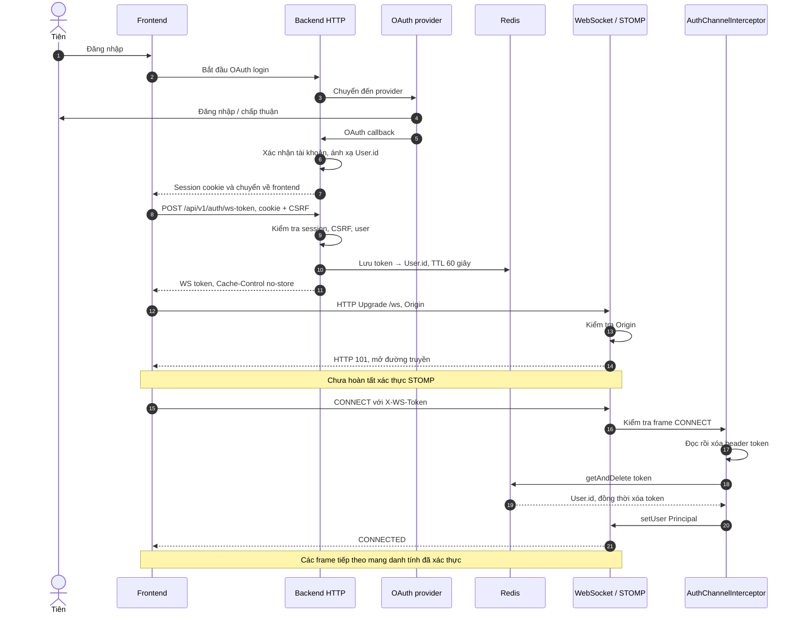
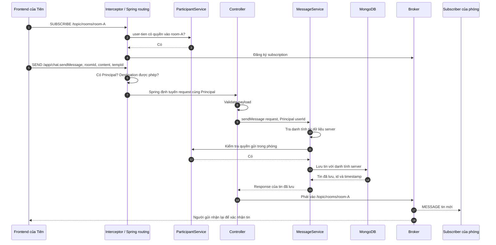

# Audit trao đổi: CM-003 — xác thực WebSocket/STOMP và trả lỗi riêng

- Ngày tổng hợp: 2026-10-11 (Asia/Bangkok).
- Loại tài liệu: tổng hợp cuộc trao đổi và đánh giá thiết kế dựa trên đọc code/tài liệu.
- Trạng thái: ghi nhận và đề xuất; không phải spec Approved, ticket triển khai hay chứng nhận bảo mật.
  **Đã triage 2026-10-12:** WS-A01..A14 được phân loại trong `docs/plan/MVP_V0_PLAN.md` (mục "Triage of the CM-003 WebSocket audit"); phần v0 nằm trong CM-068.
- Phạm vi: CM-003, liên hệ CM-004, luồng gửi tin, `/user/queue/errors`, reconnect và vòng đời quyền truy cập.
- Bằng chứng: code/tài liệu đã đọc trong cuộc trao đổi; một số điểm được đối chiếu lại khi lưu audit. Không chạy test, probe tấn công, kiểm tra production hoặc full verification trong lượt lưu này.

## 1. Kết luận chính

Thiết kế xác thực bằng token ngắn hạn dùng một lần phù hợp với kiến trúc HTTP session + Spring STOMP của ChatMee. Gửi lỗi ứng dụng qua `/user/queue/errors` là cơ chế hợp lệ được Spring hỗ trợ; broker không làm luồng này sai.

Các phần cần đánh giá thêm là vòng đời xác thực sau CONNECT, thu hồi subscription khi mất quyền, trả kết quả về đúng phiên và xử lý kết quả chưa xác định khi mạng mất. Đây là follow-up cần xác nhận yêu cầu, không phải kết luận rằng CM-003 phải bị thay thế.

Lưu ý về snapshot: cuộc trao đổi ban đầu dùng `/topic/public/{roomId}`. Khi lưu audit, `ChatWebSocketController` trong working tree đã phát tin vào `/topic/rooms/{roomId}`. Sơ đồ dưới dùng tên hiện tại; khác biệt tên không thay đổi nguyên lý xác thực/trả lỗi. Working tree đang có thay đổi và conflict ngoài phạm vi; audit không giải quyết hoặc xác nhận các thay đổi đó.

## 2. Những câu hỏi đã được giải đáp

| Câu hỏi trong cuộc trao đổi | Nội dung trả lời |
|---|---|
| CM-003 làm gì? | Xác thực STOMP CONNECT và lấy danh tính người gửi từ Principal của server. |
| Thiết kế đã đúng chưa? | Đúng hướng ở bước mở phiên; cần đánh giá vòng đời sau CONNECT và thu hồi quyền. |
| Gọi tên luồng và giải thích thành phần | Single-use token authentication for STOMP over WebSocket; xem mục 3–4. |
| Interceptor và bước kiểm tra SEND là gì? | Chốt kiểm tra frame đầu vào; Spring định tuyến sau khi frame được cho đi tiếp. |
| Các nhánh lỗi nằm ở đâu? | HTTP API, handshake, CONNECT, SUBSCRIBE, SEND và Controller/Service; xem mục 6. |
| `/user/queue/errors` có giữ tin lỗi không? | Không; đó là địa chỉ nhận thông báo lỗi realtime riêng, không phải kho lưu tin thất bại. |
| Vì sao không trả lỗi trực tiếp? | WebSocket làm được; STOMP dùng destination/subscription để tổ chức phản hồi bất đồng bộ. |
| Thiết kế thực tế nên thế nào? | Có thể HTTP + WS hoặc STOMP hai chiều; cần tương quan yêu cầu/kết quả và xử lý mất xác nhận. |

## 3. Tên luồng, vai trò và thuật ngữ

**Tên:** Xác thực STOMP qua WebSocket bằng token ngắn hạn dùng một lần — Single-use token authentication for STOMP over WebSocket.

**Vai trò:** chuyển danh tính đã được xác thực qua HTTP sang một kết nối realtime, để backend biết kết nối thuộc về ai mà không tin userId do client khai báo.

| Thành phần | Vai trò |
|---|---|
| HTTP session | Hồ sơ đăng nhập ở backend. |
| Session cookie | Mã tham chiếu session, được trình duyệt gửi theo cấu hình cookie. |
| CSRF token | Bảo vệ yêu cầu HTTP dùng cookie, bao gồm yêu cầu xin WS token. |
| WebSocket | Đường truyền hai chiều giữ mở. |
| STOMP | Giao thức thông điệp trên WebSocket: CONNECT, SUBSCRIBE, SEND, MESSAGE, ERROR… |
| Frame | Một thông điệp STOMP gồm lệnh, header và có thể có body. |
| WS token | Vé dùng một lần để xác thực CONNECT; khác session cookie và CSRF token. |
| Redis | Giữ ánh xạ token → User.id với TTL và cho phép consume nguyên tử. |
| AuthChannelInterceptor | Kiểm tra frame trước khi được xử lý tiếp. |
| Principal | Danh tính server gắn vào kết nối sau xác thực. Tên là User.id nội bộ. |
| Controller | Nhận yêu cầu qua @MessageMapping, kiểm tra dữ liệu và gọi Service. |
| Service | Xử lý nghiệp vụ, kiểm tra quyền và lưu dữ liệu. |
| Spring user-destination handler | Ánh xạ địa chỉ `/user/...` thành địa chỉ của các phiên liên quan. |
| Broker | Phân phối thông điệp đến subscription. Simple broker hiện chạy trong backend. |

Authentication trả lời “kết nối thuộc về ai?”. Authorization trả lời “người đó được thực hiện hành động nào?”. Quản lý vòng đời trả lời “khi nào danh tính/quyền đó hết hiệu lực?”.

## 4. Luồng đăng nhập và kết nối đầy đủ



Handshake mở đường truyền; CONNECT xác thực ở tầng STOMP. `X-WS-Token` là header STOMP, không phải custom header HTTP của WebSocket handshake.

`/ws/**` được permitAll/CSRF-ignore ở tầng HTTP theo thiết kế token; endpoint vẫn kiểm tra Origin và CONNECT vẫn cần token. Không được suy diễn permitAll thành “ai cũng được chat”.

Token được tạo từ 32 byte SecureRandom, mã hóa Base64 URL-safe, lưu với TTL 60 giây. `getAndDelete` lấy và xóa nguyên tử: hai kết nối dùng cùng token thì chỉ một lần consume lấy được giá trị. TTL là hạn dùng vé trước CONNECT, không phải tuổi thọ socket đã xác thực.

Cross-site không tự động có nghĩa cookie luôn không thể dùng. Khả năng dùng cookie còn phụ thuộc domain, SameSite và chính sách trình duyệt. Token giảm phụ thuộc vào cấu hình cookie giữa các bên triển khai; đây là diễn đạt chính xác hơn lý do đơn giản hóa trong ADR.

## 5. Interceptor, SUBSCRIBE và SEND

Frontend không gọi Interceptor trực tiếp. Spring tự đưa frame đầu vào qua interceptor đã đăng ký. Interceptor không trực tiếp gọi Controller; sau khi frame được cho đi tiếp, Spring định tuyến theo destination.

| Frame | Kiểm tra trong AuthChannelInterceptor |
|---|---|
| CONNECT / STOMP | Token hợp lệ; gắn Principal. |
| SUBSCRIBE | Có Principal, destination hợp lệ, membership nếu là kênh phòng. |
| SEND | Có Principal, destination nằm trong allowlist. |

Trong bước SEND, kiểm tra destination chưa phải kiểm tra toàn bộ quyền gửi vào roomId trong body. Controller/Service tiếp tục kiểm tra dữ liệu và quyền nghiệp vụ.



Client không được SEND trực tiếp vào topic để bỏ qua Controller/Service. SenderId/senderName không được lấy theo khai báo của client.

## 6. Các nhánh lỗi

| Điểm phát hiện | Ví dụ | Cách báo lỗi trong luồng được trao đổi |
|---|---|---|
| HTTP xin token | Chưa đăng nhập / session hết hạn | HTTP 401; không cấp token. |
| HTTP xin token | CSRF thiếu/sai | HTTP 403; không cấp token. |
| WebSocket handshake | Origin không được phép | HTTP 403; không mở transport. |
| CONNECT | Token thiếu/sai/hết hạn/đã dùng | STOMP ERROR rồi đóng kết nối. |
| SUBSCRIBE | Kênh bị cấm / không có membership | STOMP ERROR rồi đóng kết nối. |
| SEND interceptor | Principal thiếu / destination bị cấm | STOMP ERROR rồi đóng kết nối. |
| Controller validation | Payload không hợp lệ | Thông báo riêng VALIDATION_FAILED; giữ kết nối. |
| Service authorization | Không có quyền gửi vào phòng | Thông báo riêng FORBIDDEN_ACTION; giữ kết nối. |
| Xử lý gửi tin | Lưu DB thất bại | Thông báo riêng INTERNAL_ERROR; không phát tin thất bại vào phòng. |

Không thể phân loại đơn giản “authorization luôn đóng kết nối”. Cùng là thiếu quyền, SUBSCRIBE bị từ chối ở interceptor và SEND bị từ chối ở service có thể có cách xử lý khác nhau.

STOMP ERROR là frame giao thức; đặc tả yêu cầu đóng kết nối sau khi gửi ERROR. Lỗi ứng dụng trong body của MESSAGE là cơ chế khác, có thể giữ kết nối. HTTP response chỉ áp dụng trước khi transport chuyển sang WebSocket.

## 7. Bản chất và hoạt động của /user/queue/errors

Đây là địa chỉ nhận thông báo lỗi riêng, không phải nơi lưu tin chat gửi thất bại. Chữ `queue` không tự cung cấp persistence hoặc phát lại sau reconnect. Simple broker hiện tại không bảo đảm lưu thông báo lỗi cho client đang offline.

Frontend subscribe `/user/queue/errors`. Backend gọi:

```java
messagingTemplate.convertAndSendToUser(
    principal.getName(), "/queue/errors", error);
```

Spring user-destination handler tìm phiên của user, ánh xạ địa chỉ riêng, rồi broker phân phối đến subscription. Backend không truyền `/user` vào tham số destination vì phương thức gửi theo user đã thực hiện vai trò đó.

Ví dụ dữ liệu lỗi minh họa:

```json
{
  "tempId": "tmp-123",
  "code": "FORBIDDEN_ACTION",
  "message": "Room membership required"
}
```

Frontend ghép tempId với tin tạm đang giữ để đánh dấu thất bại. Thông báo không chứa cơ chế tự lưu/gửi lại tin chat. Nó vẫn được vận chuyển bằng frame MESSAGE, không phải STOMP ERROR.

Code hiện gửi theo Principal; nhiều tab/thiết bị cùng user và cùng subscribe có thể cùng nhận lỗi. “Riêng cho user” khác “riêng cho phiên gửi”. Spring hỗ trợ `@SendToUser(destinations="/queue/errors", broadcast=false)` trong handler để nhắm phiên phát sinh yêu cầu; nếu chọn messaging template, cần định tuyến phiên phù hợp. Đây là lựa chọn cải thiện, không phải thay đổi đã làm.

## 8. Vì sao cần broker? Có thể respond trực tiếp không?

WebSocket thuần có thể nhận thông điệp rồi gửi lỗi trên chính socket, không cần broker. Nhưng ứng dụng phải tự quy định kiểu phản hồi và requestId, cũng như quản lý kết nối đích.

HTTP tự gắn response với request đang chờ. WebSocket/STOMP cần hợp đồng ở tầng ứng dụng để ghép kết quả với SEND. ChatMee đã chọn STOMP, destination và subscription; broker là cơ chế phân phối đang có, không phải một tầng kiểm tra lỗi bắt buộc do WebSocket yêu cầu.

| Lựa chọn | Gửi lệnh | Nhận kết quả | Nhận sự kiện phòng |
|---|---|---|---|
| HTTP + WS | POST /messages | HTTP response | WebSocket |
| WebSocket thuần | Message action + requestId | Reply trên socket | Message sự kiện |
| Spring STOMP | SEND /app/... | MESSAGE trên destination riêng hoặc sự kiện có correlation | Subscription topic |

Không có cơ sở trong cuộc trao đổi để khẳng định mọi hệ thống thực tế đều chọn một phương án. HTTP + WS dễ hiểu với REST; STOMP hai chiều hợp lý khi đã dùng messaging. Broker đơn giản đang chạy trong Spring, không đồng nghĩa phải triển khai thêm RabbitMQ.

## 9. Thiết kế kết quả gửi tin và những giới hạn cần xử lý

Luồng hiện được trao đổi: thành công qua tin đã lưu phát lại vào phòng, thất bại qua kênh lỗi riêng. Đây là hợp đồng hợp lệ nếu tempId và messageId được xử lý nhất quán.

Một phương án bổ sung là kênh kết quả riêng gồm cả success/error, có requestId và nhắm đúng phiên gửi. Nó giúp tách kết quả lệnh khỏi sự kiện của phòng; không bắt buộc đổi `/queue/errors` thành `/queue/results`.

Điểm cần chú ý: lưu DB và phát thông báo không phải một thao tác nguyên tử. Backend có thể lưu thành công rồi socket/broker thất bại. Vì vậy:

- Timeout không chứng minh tin chưa được lưu; kết quả có thể là chưa xác định.
- Thông báo INTERNAL_ERROR từ đường xử lý tổng quát cũng không tự chứng minh DB chưa có tin nếu lỗi xảy ra sau bước lưu.
- Reconnect nên đối chiếu lịch sử để bù tin bỏ lỡ.
- Nếu cho gửi lại, cần cơ chế idempotency được thực thi ở backend; tempId dùng để tương quan chưa tự chống lưu trùng.
- STOMP RECEIPT xác nhận xử lý frame theo giao thức, không tự thay thế hợp đồng xác nhận lưu nghiệp vụ của ứng dụng.

## 10. Reconnect, logout và thu hồi quyền

Reconnect: mất socket → backoff → xin token mới qua HTTP session → mở WebSocket → CONNECT → subscribe lại → resync lịch sử. Không tái sử dụng token đã consume. Cần phân biệt lỗi 401/403 kết thúc phiên với lỗi mạng tạm thời để tránh retry vô ích.

Logout hiện được trao đổi: hủy HTTP session, frontend thay đổi trạng thái auth và dừng socket. Đọc code trong cuộc trao đổi chưa tìm thấy liên kết backend HTTP session → WS connections để chủ động đóng socket. Không coi frontend đóng kết nối là bằng chứng server đã thu hồi quyền cho client không hợp tác.

Token chỉ chứa userId: token cấp trước logout có thể vẫn dùng được trong TTL nếu không có cơ chế kiểm tra/thu hồi bổ sung. Token một lần chống reuse nhưng không chống việc kẻ lấy được token dùng trước chủ sở hữu.

Đề xuất vòng đời: liên kết phiên đăng nhập với vé chưa dùng và socket đã mở; định nghĩa logout một phiên hoặc mọi phiên; thu hồi vé và socket tương ứng; hỗ trợ sự kiện thu hồi giữa các instance. Chọn giới hạn tuổi thọ/revalidation theo yêu cầu sản phẩm, không áp đặt tùy ý 60 giây cho socket.

Quyền đọc phòng: membership kiểm tra lúc SUBSCRIBE không tự thu hồi subscription cũ khi bị loại khỏi phòng. Follow-up cần quyết định đóng/unsubscribe phía server hoặc kiểm tra phân phối phù hợp; không dựa riêng vào frontend.

## 11. Follow-ups và study cases cần kiểm chứng

Các mục dưới là đề xuất để lập ticket riêng theo spec/design/plan; chưa được triển khai hoặc chạy kiểm thử trong audit này.

| ID audit | Tình huống | Kết quả cần định nghĩa / kiểm chứng |
|---|---|---|
| WS-A01 | Hai instance consume cùng token | Chỉ một CONNECT thành công. |
| WS-A02 | Token cấp trước logout | Phiên bị thu hồi thì vé chưa dùng được xử lý theo chính sách đã chọn. |
| WS-A03 | Logout khi client giữ socket | Backend thu hồi đúng phạm vi phiên mà không phụ thuộc frontend. |
| WS-A04 | HTTP session hết hạn / tài khoản bị khóa | Xác định và thực thi thời gian thu hồi quyền socket. |
| WS-A05 | Bị loại khỏi phòng khi subscription đang mở | Không tiếp tục nhận dữ liệu cần bảo vệ sau thu hồi theo chính sách. |
| WS-A06 | Hai tab của cùng user gửi đồng thời | Kết quả ghép đúng yêu cầu; chọn trả về đúng phiên. |
| WS-A07 | Save thành công, mất xác nhận | Không kết luận chắc chắn chưa lưu; resync tìm được tin. |
| WS-A08 | Retry sau timeout | Không lưu trùng khi có hợp đồng idempotency. |
| WS-A09 | Redis down khi CONNECT | Không chấp nhận CONNECT chưa xác thực; lỗi không làm lộ token. |
| WS-A10 | Mở socket nhưng không CONNECT | Kiểm tra timeout và giới hạn kết nối chưa xác thực, kể cả mặc định framework. |
| WS-A11 | Reconnect đồng loạt | Backoff; đánh giá jitter và tải endpoint cấp token. |
| WS-A12 | HTTP 401/403 khi reconnect | Không lặp vô hạn như lỗi mạng; xử lý hết phiên rõ ràng. |
| WS-A13 | Token bị lấy trước khi consume | Hiểu giới hạn bearer token; HTTPS/WSS và không ghi token vào log. |
| WS-A14 | SUBSCRIBE kênh lỗi rồi gửi ngay | Kiểm chứng thứ tự đăng ký kênh và xử lý yêu cầu, không giả định kết quả luôn đến được. |

## 12. Nguồn đối chiếu và giới hạn audit

Tài liệu/code của dự án:

- [Ticket CM-003 trong improvement plan](IMPROVEMENT_PLAN.md).
- [ADR-0004](../adr/0004-websocket-authentication-token.md).
- [WebSocket protocol](../design/websocket-protocol.md).
- [WsTokenService](../../backend/src/main/java/com/lnt/chatmee/security/WsTokenService.java).
- [AuthChannelInterceptor](../../backend/src/main/java/com/lnt/chatmee/security/AuthChannelInterceptor.java).
- [AuthApiController](../../backend/src/main/java/com/lnt/chatmee/controller/AuthApiController.java).
- [ChatWebSocketController](../../backend/src/main/java/com/lnt/chatmee/controller/ChatWebSocketController.java).
- [SecurityConfig](../../backend/src/main/java/com/lnt/chatmee/config/SecurityConfig.java).
- [WebSocketConfig](../../backend/src/main/java/com/lnt/chatmee/config/WebSocketConfig.java).
- [stompSession](../../frontend/lib/realtime/stompSession.ts) và [StompProvider](../../frontend/lib/realtime/StompProvider.tsx).

Nguồn chính thức đã được tra cứu trong cuộc trao đổi:

- [Spring: Token Authentication](https://docs.spring.io/spring-framework/reference/web/websocket/stomp/authentication-token-based.html): xác thực header CONNECT, ChannelInterceptor và setUser.
- [Spring: User Destinations](https://docs.spring.io/spring-framework/reference/web/websocket/stomp/user-destination.html): định tuyến `/user`, nhiều phiên và `broadcast=false`.
- [STOMP 1.2 specification](https://stomp.github.io/stomp-specification-1.2.html): MESSAGE, RECEIPT và ERROR/đóng kết nối.
- [OWASP WebSocket Security Cheat Sheet](https://cheatsheetseries.owasp.org/cheatsheets/WebSocket_Security_Cheat_Sheet.html): WSS, Origin, session expiry/logout, giới hạn kết nối và bảo vệ token.

Tài liệu Spring online có thể hiển thị phiên bản mới hơn stack của dự án; dùng để đối chiếu khái niệm, không phải xác nhận tương thích phiên bản bằng test.

Audit này là bản tổng hợp có cấu trúc, không phải transcript nguyên văn. Nó không thay đổi Approved spec, không sửa code, không xác nhận deployment và không đóng các acceptance criteria bằng bằng chứng runtime. Các điểm “chưa thấy cơ chế” là kết quả đọc trong phạm vi cuộc trao đổi, cần kiểm chứng lại khi triển khai ticket.
