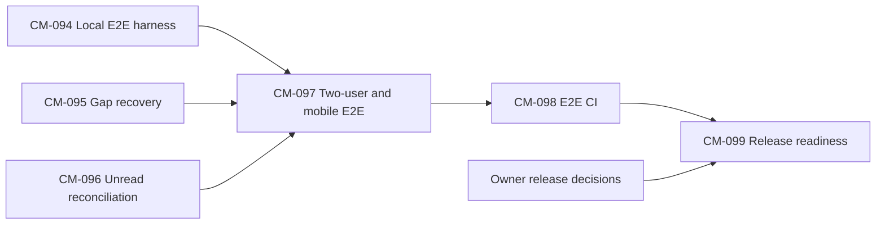

# ChatMee v0.2: stabilize first, extend by milestone

- Status: Draft for owner review; planning only, no implementation authorization.
- Date: 2026-10-25 (Asia/Bangkok).
- Audited baseline: `feat/message-actions-menu`, HEAD `f49ca3a`.
- Owner: @N-Tien-L.
- Related: [owner decisions](V0.2-OPEN-QUESTIONS.md), [planning report](V0.2-PLANNING-REPORT.md), [ticket template](_TICKET_TEMPLATE.md).

## 1. Goal, authority and evidence boundaries

Complete a small, testable user journey: sign in, find a person, accept a DM request, exchange messages, lose connectivity, recover the conversation and see correct unread state on desktop and mobile. Release that improvement independently before adding richer messaging.

The owner selected **stability first** for M1 and **automated local OAuth plus owner-run real OAuth smoke** for E2E. This selection approves the planning direction, not production changes, dependencies or unapproved spec amendments. No workers are dispatched by this document.

Authority remains specs > design > ADRs > plan. Read Approved specs together with their amendments; do not rewrite a spec to fit implementation. The old [v0.2 brief](V0.2-PLANNING-PROMPT.md) is input to evaluate, not proof of shipped functionality. Its requirement to include every mainstream chat feature is superseded by the owner's narrower request in this planning session.

This audit reads the current checkout, including owner-authored documentation edits. Existing changes in `README.md`, `docs/README.md` and untracked `docs/engineering.md` are preserved. Other worktrees and WIP branches are outside the baseline. New output is limited to the three v0.2 planning documents; the board, Approved specs, design contracts and accepted ADRs are not edited.

Evidence labels:

- **Exists:** a working implementation path and relevant source/test evidence are present; this is not a fresh test-pass claim.
- **Partial:** scaffolding or a usable subset exists, but the named journey is incomplete.
- **Missing:** no implementation path was found in the searched runtime sources; a schema field, idea or ticket is insufficient.
- All `file:line` citations below are repository-relative, one-based locations at `f49ca3a`, unless described as an uncommitted document. Proposed tests in section 5 do not exist yet.

Search coverage for Missing findings: backend models, DTOs, controllers, services, repositories, security and configuration under `backend/src/main/java/com/lnt/chatmee/`; frontend `app/`, `components/chat/`, `components/room/`, `hooks/`, `lib/api/`, `lib/types/`, `lib/stores/` and `lib/realtime/`; frontend package scripts, browser scripts and CI workflows. Search terms included reply/reaction/mention/upload/invite-link/join-requests/draft/isMuted/lastReadMessageId/PushManager/serviceWorker, followed by reading the current message and UI paths. This does not audit unmerged branches or deployed revisions.

## 2. Current-state audit

| Capability | Status | Runtime evidence (`file:line`) | Existing evidence and practical boundary |
|---|---|---|---|
| HTTP auth, session, CSRF and confirmed logout | Exists | `backend/src/main/java/com/lnt/chatmee/config/SecurityConfig.java:62`; `frontend/lib/stores/authStore.ts:69` | `frontend/lib/stores/authStore.test.ts:31` and `:43` cover rejected/confirmed logout. `/auth/me`, not persisted auth flags, gates the socket. Cold-start/network errors are distinguished from guest state in the store. |
| Server-side WS logout/session-expiry revocation | Missing | `backend/src/main/java/com/lnt/chatmee/security/WsTokenService.java:24` and `:35`: token maps to user, consumed once, TTL 60 seconds | `docs/specs/SPEC-008-mvp-v0.md:25` explicitly defers revoking existing sockets and unused tokens. Client socket stop is a different guarantee. |
| Two-person messaging and consent | Exists | `backend/src/main/java/com/lnt/chatmee/service/MessageService.java:59`; `frontend/components/chat/ChatInterface.tsx:228` | `frontend/components/chat/ChatInterface.request.test.tsx:61`; `docs/plan/V0-SMOKE-REPORT.md:12` and `:51`. REQUESTED allows one sender message, then accept/reply activates the DM. |
| Block, hide and report | Exists | `backend/src/main/java/com/lnt/chatmee/service/MessageService.java:158`; `frontend/lib/stores/chatRoomsStore.ts:327` | `docs/plan/V0-SMOKE-REPORT.md:19` through `:21`; CM-080 report. Reports are stored only; no review console. Shared group rooms are unaffected by DM blocking. |
| Idempotent persistence, lost-echo reconciliation, Resend/Discard | Exists | `backend/src/main/java/com/lnt/chatmee/service/MessageService.java:241`; `frontend/hooks/useRoomMessage.ts:277` | `backend/src/test/java/com/lnt/chatmee/repository/MessageRepositoryIT.java:156`; `frontend/hooks/useRoomMessage.test.ts:48` and `:65`. A duplicate save resolves to one stored message; activity/broadcast may still repeat. |
| History and older-page navigation | Exists | `backend/src/main/java/com/lnt/chatmee/controller/MessageController.java:37`; `backend/src/main/java/com/lnt/chatmee/repository/MessageRepository.java:19`; `frontend/hooks/useRoomMessage.ts:169` | `before` cursor uses timestamp plus typed ID tie-break. No public `after` endpoint. Repository tests cover tied timestamps and mixed legacy IDs. |
| Reconnect, subscription restoration and banner | Partial | `frontend/hooks/useRoomMessage.ts:202`; `frontend/lib/realtime/StompProvider.tsx:90`; `frontend/components/chat/ChatInterface.tsx:341` | `frontend/lib/realtime/StompProvider.test.tsx:85`; `docs/plan/V0-SMOKE-REPORT.md:23`. Newest-page refetch is present, but a gap larger than that page is not walked back to overlap. |
| Room unread count, mark-read and browser title | Partial | `frontend/lib/stores/chatRoomsStore.ts:141` and `:151`; `frontend/components/room/ChatRoomsList.tsx:78` and `:93`; `backend/src/main/java/com/lnt/chatmee/repository/MessageRepository.java:51` | `backend/src/test/java/com/lnt/chatmee/service/RoomUnreadIT.java:26`; `frontend/components/room/ChatRoomsList.title.test.tsx:37`. Duplicate activity can increment again; failed optimistic mark-read has no immediate reconciliation. |
| Read marker versus delivery/read receipts | Partial: unread marker only | `backend/src/main/java/com/lnt/chatmee/service/ParticipantService.java:186`; `backend/src/main/java/com/lnt/chatmee/repository/ParticipantRepository.java:32` | Server sets `lastReadAt` to now using `$max`; own/SYSTEM/deleted messages do not count. Server echo confirms persistence, not recipient delivery or reading. No per-message seen marker/UI found. |
| Mobile conversation journey and browser automation | Partial | `frontend/app/dashboard/page.tsx:63`; `frontend/package.json:5`; `.github/workflows/frontend-ci.yml:1` | `docs/plan/V0-SMOKE-REPORT.md:24` records 360 px smoke; `frontend/tests/browser/search-dialog-stability.js:1` and `account-menu.js:1` are focused browser scripts. No checked-in Playwright E2E runner or full-stack E2E CI job. |
| Existing actions menu and time presentation | Exists | `frontend/components/chat/MessageActions.tsx:30`, `:65`, `:73`; `frontend/components/chat/MessageList.tsx:19` and `:424` | `frontend/components/chat/MessageList.timestamps.test.tsx:34` covers hour gaps; latest-own-message sent mark has tests in the same file. Menu supports click/tap/contextmenu. Full touch and keyboard regression coverage remains part of M1. |
| Reply, quoted preview and jump-to-original | Missing | `backend/src/main/java/com/lnt/chatmee/model/Message.java:26`; `frontend/components/chat/MessageActions.tsx:60` | No reply relation, target lookup/context endpoint or quoted-message UI found. Accepting a DM request by replying is unrelated. |
| Reactions, counts, who-reacted and quick gestures | Missing | `backend/src/main/java/com/lnt/chatmee/model/Message.java:26`; `frontend/components/chat/MessageActions.tsx:60` | No reaction persistence, mutation API, event or UI found. Double-tap cannot be assigned without considering the existing tap-menu gesture. |
| Per-room drafts | Missing | `frontend/components/chat/ChatInterface.tsx:133`, `:237`; `frontend/app/dashboard/page.tsx:63` | Composer text is component state; keyed room remount discards it. Keeping text during a reconnect of the same mounted view is not per-room draft storage. |
| Edit own message | Missing | `backend/src/main/java/com/lnt/chatmee/model/Message.java:46`; `backend/src/main/java/com/lnt/chatmee/controller/MessageController.java:37` | `updatedAt`/`isUpdated` exist, but no edit API, time/permission rule, revision policy or edited UI workflow found. |
| Delete-for-me and unsend-for-everyone | Missing | `backend/src/main/java/com/lnt/chatmee/model/Message.java:50`; `backend/src/main/java/com/lnt/chatmee/repository/MessageRepository.java:19` | `isDeleted` currently filters history out. It is not a per-user hide model or a persistent unsent tombstone. |
| Images/files: storage, upload, preview and authorized download | Partial: schema only | `backend/src/main/java/com/lnt/chatmee/model/Message.java:42` and `:52`; `backend/src/main/java/com/lnt/chatmee/dto/request/ChatMessageRequest.java:31` | Attachment URL list/media enums exist; client SEND is TEXT-only. No upload/finalize/access/quota/cleanup workflow found. |
| In-conversation message search, highlight and jump | Missing | `backend/src/main/java/com/lnt/chatmee/controller/MessageController.java:37`; `frontend/lib/stores/chatRoomsStore.ts:397` | Room filtering uses room metadata, not message content. User search is also a separate feature. No message-search endpoint/UI found. |
| Mentions and mention notifications | Missing | `backend/src/main/java/com/lnt/chatmee/model/Message.java:26`; `frontend/components/chat/MessageInput.tsx:53` | No mention identities, validation, persisted recipients or notification flow found. |
| Room mute | Partial: field only | `backend/src/main/java/com/lnt/chatmee/model/Participant.java:51`; `docs/specs/SPEC-009-membership-consent-and-safety.md:77` | `isMuted` is unused by notification behavior; AC-009-27 is explicitly deferred. |
| Browser push and notification sound | Missing | `frontend/package.json:5`; `frontend/lib/realtime/StompProvider.tsx:90` | No push subscription API, delivery worker/service worker or sound preference flow found. Browser title unread already exists. |
| New-messages divider and mark-as-unread | Missing | `docs/specs/SPEC-008-mvp-v0.md:15`; `frontend/components/room/ChatRoomsList.tsx:78` | A new-messages scroll button is not an in-history unread divider; no backwards/unread marker operation found. |
| Forward, room pin and multi-select | Missing | `frontend/components/chat/MessageActions.tsx:60`; `backend/src/main/java/com/lnt/chatmee/controller/MessageController.java:37` | No matching message action model/API/UI found. |
| Auto-links, rich formatting and fetched link previews | Missing | `frontend/components/chat/MessageList.tsx:393` and `:473` | Content renders as escaped plain text. No link renderer, markdown parser or metadata-fetch service found; plain rendering is a useful XSS boundary. |
| Room media/files/links navigation and jump-to-date | Missing | `backend/src/main/java/com/lnt/chatmee/controller/MessageController.java:37` | History has `before` only; no media index or date/context navigation capability found. |
| Removal versus bans/cooldown/report review | Partial | `docs/specs/SPEC-009-membership-consent-and-safety.md:61` and `:73`; `docs/plan/CM-066-REPORT.md:10` | Member removal and store-only reporting exist; bans, cooldown AC-009-26 and moderation review remain deferred. |
| Cross-instance room-message fan-out | Missing | `backend/src/main/java/com/lnt/chatmee/config/WebSocketConfig.java:44`; `docs/adr/0002-redis-for-presence-and-rate-limit.md:24` | Simple broker is instance-local. Redis presence fan-out is implemented separately and is not room-message fan-out. |
| Room share links and private join requests | Missing in this baseline | `docs/specs/SPEC-010-room-share-links.md:2`; `docs/adr/0007-room-share-links.md:2` | Draft/Proposed only; no corresponding runtime routes found. No assumption is made about unmerged WIP branches. |

### 2.1 Contradictions and stale records

| Record | Conflict | Planning treatment |
|---|---|---|
| `docs/plan/V0.2-PLANNING-PROMPT.md:16` | Says v0.1 shipped share links; SPEC-010 is Draft and ADR-0007 Proposed. | Record share links as Missing in this baseline and excluded from M1. Approval is required before implementation. |
| `docs/plan/BOARD.md:62`, `:74`, `:75` | CM-066/079/080 remain todo, but code and later reports show integration. | Use source plus `docs/plan/CM-067-INTEGRATION-REPORT.md:9` and subsequent smoke rounds; do not redispatch these tickets or silently repair the board. |
| `docs/plan/V0.2-PLANNING-PROMPT.md:29` | Calls CM-093 a parked draft and asks to close it. | `docs/plan/CM-093-message-time-reveal.md:3` already closes it as superseded. Preserve its worktree/branch. |
| `CHANGELOG.md` v0.1.0 entry and CM-067 release actions | Feature integration and historical green gates do not establish completed release sign-off, rotation, backfills, tagging or deployed SHA. | Owner confirms release lineage before choosing a milestone version/tag (OQ-02). No production calls in this audit. |
| `docs/specs/SPEC-004-messaging-realtime.md:32` versus `:48` | Earlier table says idempotency unimplemented; the later resolved decision and SPEC-008 AC-008-13 establish implementation. | Apply the resolved requirement and cite current code/tests. Do not edit Approved text in this planning round. |
| `docs/specs/SPEC-004-messaging-realtime.md:26` | Reconnect is called Implemented, with an explicit newest-page limitation; it is not full multi-page recovery. | Mark the journey Partial and plan a compatible frontend fix; do not claim an existing `after` endpoint. |
| `docs/plan/CM-067-INTEGRATION-REPORT.md:89` and later spec amendments | Earlier open items and approval-pending notes precede later smoke and approved known-gap amendments. | Preserve history; read later sections and SPEC-008 section 10 before treating an old finding as current. |
| `docs/plan/LOCAL-CLEANUP-2026-10-16.md` | Records discovery WIP with colliding CM/SPEC/ADR identifiers. | Do not import WIP features or allocate SPEC/ADR IDs from that branch. Allocate future identifiers only after a fresh namespace check. |

Historical verification: `docs/plan/V0-SMOKE-REPORT.md:64` records 582 backend unit/slice tests, 105 ITs and 382 frontend tests plus gates on the stated historical revision. Its browser checks used a release-worktree backend and develop frontend. Network faults were simulated (`:30`); later fixes/re-smokes close earlier findings (`:41`, `:58`, `:63`). These are useful evidence with revision/method limits, not new passes at `f49ca3a`.

## 3. Scope, priorities and independent releases

| Milestone | User outcome and priority | Prerequisites and release boundary |
|---|---|---|
| **M1: Reliable two-person chat** | P1. Auth/session journey, multi-page recovery, unread reconciliation, repeatable two-person E2E and mobile verification. | First proposed release. No new production service, schema, REST API or STOMP destination. Complete CM-094..099 and owner release decisions. |
| **M2: Compose continuity** | P2. An unsent per-room draft survives switching conversations; account isolation and cleanup are explicit. | Optional follow-on, independently releasable after M1. Approve draft storage/lifetime (OQ-04), then a Draft spec and small implementation ticket. |
| **M3: Contextual reply** | P2. Quote a permitted message and jump to its original, including outside the loaded page. | Optional follow-on after M1; M2 is useful but not a backend dependency. Approve reply spec/amendments and target-context authorization first. |
| **M4: Lightweight reactions** | P2. Add/remove a reaction, see counts and paged who-reacted details. | Optional after M1; assessed after M2/M3 review. Requires reaction spec, limits and reconnect reconciliation. No automatic commitment to include it in v0.2. |

M1 does not wait for M2..M4. Its name describes the proposed release content, not an SLA. Owner may end v0.2 after M1. Candidate milestones are not dispatch-ready implementation tickets until their product decisions and Approved spec coverage exist.

### 3.1 Explicit deferrals

| Group | Why deferred / condition for reconsideration |
|---|---|
| Edit, delete-for-me, unsend | Requires owner policy on time windows, retained content/history, moderation and private hiding; also needs quote, search, preview, unread and reconnect behavior. Reconsider as one separately specified lifecycle milestone, split into small tickets. |
| Images and files | Requires private object storage, budget, MIME/size validation, quarantine/scan policy, authorized download, orphan cleanup and retention. Start with image-only pilot if approved. Do not store durable uploads on Render local disk. |
| Message search | Needs current access checks, bounded queries and consistent treatment of edited/hidden/unsent content. Measure data volume before choosing an external index. |
| Mentions, mute and push | Needs one notification/privacy model, preferences, deduplication, suppression and failure handling. `isMuted` alone does not implement that model. |
| Read receipts / recipient delivered state | Current read-at-now marker and sender echo do not prove viewport visibility or device delivery. Needs a separately approved model and privacy default. |
| New-messages divider / mark-as-unread | Requires a stable entry/read boundary and explicit relationship to existing read-at-now semantics. Avoid turning unread stabilization into a read-model migration. |
| Forward, pin, multi-select, media tabs, jump-to-date | Additional journeys with separate rights and navigation semantics; none closes M1's recovery gap. |
| Link previews, markdown and emoji picker | Defer new content/rendering paths. Link preview adds SSRF; markdown adds XSS/sanitization decisions. Existing plain-text rendering remains adequate for M1. |
| Manual moderation, admin deletion, ban/rejoin cooldown | Needs policy and authorization decisions; SPEC-009 defers these. Existing removal/block/report remain regression coverage. |
| Share links / join requests | Existing SPEC-010 and ADR-0007 need owner approval and reconciliation of identifier collisions; unrelated to reliable two-person recovery. |
| Cross-instance fan-out, durable replay, outbox, shared sessions | Additional architecture and operations. M1 assumes one Render backend process and best-effort events with REST reconciliation. |
| Whole-system package/DTO refactor, dependency upgrades, presence privacy redesign | Do not bundle into stabilization; create follow-ups only when a concrete regression requires work. |

Voice, GIF/sticker and location sharing are v0.3-or-later candidates only: each adds a new content, permission or delivery workflow before the current text journey is fully covered.

## 4. M1 implementation design delta (Draft, no contract edits)

### 4.1 Compatibility and interfaces

- Keep `GET /api/v1/rooms/{roomId}/messages?before=<cursor>&limit=<n>` and the existing response shape. No `after`, replay endpoint, new error code or schema migration is proposed for M1.
- Keep existing STOMP destinations, allowlists, server Principal identity, CSRF, CORS and WebSocket origin restrictions. Test-only OAuth registration overrides must not enter the production artifact.
- Introduce internal frontend recovery state: idle/loading/incomplete/error/complete, a saved cursor/anchor and a generation tied to room/account/reconnect. This state is not a new wire type or a receipt.
- Preserve read-at-now semantics of SPEC-008 AC-008-3/4. Opening a visible room marks it read even if the reader scrolls back. A viewport-based marker or read receipt needs a different approved spec.

### 4.2 Multi-page recovery

1. Before reconnect recovery, capture the newest **server-confirmed** message from the previously loaded contiguous newest segment; never use an optimistic message as the overlap anchor. Subscribe/restore the existing room stream and preserve live frames while REST recovery proceeds.
2. Fetch the newest page. Continue backwards using its `nextCursor` until the anchor ID appears or history is exhausted. Use cursor semantics, not a client timestamp-only comparison, so equal timestamps and legacy string/ObjectId boundaries remain server-defined.
3. If there is no confirmed anchor (including a failed initial load), recover the newest page as the initial segment and expose its older cursor normally. Do not fetch all historic messages merely because the cache is empty.
4. Merge saved pages/live frames by server ID and reconcile own optimistic copies by `clientMessageId`/`tempId`. Keep earlier loaded pages and the scroll anchor; never present the two sides of an incomplete gap as a continuous recovered sequence.
5. Fetch sequentially, at most ten pages per automatic recovery round. If more pages are needed, show a continuation action and retain the cursor. This is a work bound, not silent truncation. Honor 429 `Retry-After`; on network/5xx show retryable incomplete state. Stop on 401 or revoked membership using existing auth/ended-room behavior.
6. A room switch, account change, logout or newer recovery generation invalidates old work. No stale response or timer may mutate the new room/account cache. Resume from a failed round's saved progress without duplicating rows.

The target is complete recovery of the missed persisted interval under the current single-instance history ordering contract. This is not durable replay or exactly-once transport. A late persistence with an earlier application timestamp and ordering races need explicit tests/limitations; if fixing them requires a new sequence/contract, stop and propose a separate amendment rather than silently expanding CM-095.

### 4.3 Unread reconciliation

- Reproduce duplicate `ROOM_ACTIVITY` delivery caused by retrying a stored client ID. `MessageService.sendMessage` still publishes activity after `persistMessage` resolves a duplicate (`MessageService.java:85`, `:108`, `:241`). Confirm with a failing test before fixing; this audit did not run that reproduction.
- Do not increment twice for an already-applied message ID, and do not move a room backwards on an older activity event. Maintain a bounded session ledger; if its retention boundary makes a delivery uncertain, refetch authoritative room state instead of guessing a count.
- Serialize/coalesce read requests per room. A failed optimistic mark-read retains a retry/reconcile requirement; refetch when reachable without overwriting a newer activity with a stale zero.
- Protect `fetchRooms`/room snapshot responses from overwriting events applied while the request was in flight. Keep per-room request generations or buffered-event reconciliation; the test oracle is agreement with a fresh server snapshot after the system becomes quiet.
- Reconnect refetch remains authoritative. Preserve own/SYSTEM/deleted exclusions, hidden-tab increments, visible-room clearing and document title behavior. Do not add background polling solely to mask races.

### 4.4 Local E2E environment

- Use isolated local MongoDB and Redis with synthetic users/content. Use the current application security chain and OAuth authorization-code callback/session/CSRF flow.
- Add a loopback OAuth fixture with authorization, token and user-info responses, synthetic identities for two separate browser contexts, and test-only client registration overrides. No production login bypass, test identity header or new `permitAll` endpoint on ChatMee.
- Keep the launcher/fixture in `backend/src/test/` and frontend test files; bind to loopback and fail closed if configured with a nonlocal service target. Use existing JDK/Spring test facilities; no new backend dependency is planned.
- Add pinned `@playwright/test` as a frontend dev dependency for repeatable browser assertions. Use Chromium in the first CI job, desktop and 360 px touch viewport; an owner-run mobile browser smoke covers real virtual-keyboard/device limitations beyond emulation.
- Use the real local backend for messaging, history and unread assertions. Fault injection may selectively drop an echo, block reconnect or intercept a logout response; label each simulated case. Do not replace all APIs with fixtures and call it full-stack E2E.
- Run against a production frontend build for final acceptance. Keep real Google/GitHub smoke separate, owner-operated, on the candidate revision without storing credentials or sessions in committed files.

## 5. M1 tickets

CM-094..099 were absent from the searched `docs/`, `backend/src/` and frontend sources on 2026-10-25. They are proposed here; recheck before dispatch. Do not reuse CM-071 (reserved) or CM-093 (closed). Each ticket is one small PR on its own ticket branch; no agent dispatch, push, merge or deployment is authorized by this document.

### Shared verification V-M1

All six tickets reference these unchecked completion criteria:

- [ ] From `backend/`: `./mvnw verify` (Windows: `mvnw.cmd verify`), with Docker available for Testcontainers.
- [ ] From `frontend/`: `npm run lint && npx tsc --noEmit && npm test && npm run build`.
- [ ] Relevant ticket documentation and evidence updated at the tested revision; no skipped/deleted failing tests, no secrets/content in logs or artifacts.
- [ ] Once available, `npm run test:e2e` against the isolated full stack; before a main release, full-stack local smoke including owner real OAuth and mobile checks.

No command in V-M1 was run during this documentation task. Historical gates do not check these boxes.

### CM-094: Establish local full-stack E2E harness

- Type: test.
- Spec: SPEC-001 AC-001-1/3/4/6/9; SPEC-008 AC-008-12/14. Design: section 4.4 of this plan; existing error-handling and WS contracts. ADR: none required for production behavior.
- Priority: P1. Estimate: M. Depends on: none.

#### Goal

Make the existing auth/session flow repeatable locally without real provider secrets, so later messaging tests can use two genuine authenticated browser contexts.

#### Scope

- In: local OAuth fixture, test-only backend launcher/config, two-context fixture and auth regression tests.
- Out: deployed OAuth configuration, auth bypasses, server-side WS revocation, changing production session storage.

#### Expected Files to Touch

- New `frontend/playwright.config.ts`, `frontend/tests/e2e/fixtures/local-stack.ts`, `frontend/tests/e2e/auth.spec.ts`.
- `frontend/package.json`, `frontend/package-lock.json`: pinned `@playwright/test`, `test:e2e` script; no unrelated upgrades.
- New `backend/src/test/java/com/lnt/chatmee/e2e/E2eApplication.java`, `LocalOAuthProvider.java`; new `backend/src/test/resources/application-e2e.properties`.
- New `frontend/tests/e2e/README.md`: local setup and evidence limits. Backend build test-launch configuration only if the existing plugin cannot launch with test classpath; record why.

#### Acceptance Criteria

- [ ] AC-1: Given an isolated local stack, when A and B complete the fake provider's authorization-code flow, then each has a distinct server-backed session and `/auth/me` survives reload. Test: `auth_loginReloadLogout_preservesSessionContract` (proposed).
- [ ] AC-2: Given a rejected logout request, when the user signs out, then identity and the usable conversation state remain; successful logout clears account caches and stops the client socket. Tests: `auth_logoutRejected_keepsSessionState`, `auth_logoutConfirmed_clearsAccountState` (proposed).
- [ ] AC-3: Given `/auth/me` or ws-token errors, when the server returns 401 versus unreachable/5xx, then the UI follows the existing expired-session versus retryable-unreachable behavior without redirect loops. Tests: `auth_expiredSession_stopsReconnect`, `auth_backendUnreachable_offersRetry` (proposed).
- [ ] AC-4: Given the normal production package, when inspected, then test launcher/provider classes and registrations are absent; a configured nonlocal target is rejected by the harness. Tests: `e2e_packagedApplication_excludesTestAuth`, `e2e_nonLocalTarget_refusesStart` (proposed packaging/harness checks).
- [ ] V-M1 passes and dependency justification is recorded.

#### Technical Notes / Hints

Use the same reverse-proxy path shapes locally. Synthetic credentials are test data, never copied from `.env`. Existing `CustomOAuth2UserServiceTest` tests user-info mapping but does not exercise browser authorization/callback flow.

#### Follow-ups

Real Google/GitHub callbacks, consent screens and deployment settings require owner smoke in CM-099. A need for another backend dependency is a documented scope decision, not permission to add one silently.

### CM-095: Recover multi-page reconnect gaps

- Type: fix.
- Spec: SPEC-004 AC-004-6/7/8; SPEC-008 AC-008-13/14. Design: sections 4.1/4.2; existing cursor contract. ADR: none; no new ordering model.
- Priority: P1. Estimate: M. Depends on: none for unit work; CM-094 for browser verification.

#### Goal

Recover a missed persisted interval larger than one history page without duplicates, false completion or messages leaking across rooms.

#### Scope

- In: backward cursor recovery, progress/retry state, generation guards and scroll preservation.
- Out: `after` API, event log/outbox, multi-instance ordering, backend schema changes.

#### Expected Files to Touch

- `frontend/hooks/useRoomMessage.ts`, `frontend/hooks/useRoomMessage.test.ts`.
- `frontend/hooks/reducers/messageReducer.ts` and related reducer tests; `frontend/lib/utils/messageUtils.ts` and resync tests.
- `frontend/components/chat/ChatInterface.tsx`, `MessageList.tsx` and focused state/scroll tests for recovery status and continuation only.
- `frontend/tests/e2e/reconnect.spec.ts` after CM-094.

#### Acceptance Criteria

- [ ] AC-1: Given an open conversation and a disconnect with more than 100 persisted messages, when reconnect recovery completes, then every missed message between the saved anchor and the recovered head appears once in server order. Test: `reconnect_moreThanOnePage_recoversEveryMessageOnce` (proposed failing reproduction first).
- [ ] AC-2: Given equal timestamps, lost echoes and live messages during recovery, when pages overlap, then server IDs/client IDs reconcile once and the reader's scroll anchor stays stable. Tests: `reconnect_tiedTimestampsAndLostEcho_keepsOneOrderedCopy`, `reconnect_liveMessageDuringPaging_preservesScrollAnchor` (proposed).
- [ ] AC-3: Given a page failure, 429 or more than ten required pages, when automatic work stops, then the UI exposes incomplete recovery and resumable retry/continue without claiming synchronization. Test: `reconnect_interruptedOrBoundedRecovery_resumesFromCursor` (proposed, parameterized).
- [ ] AC-4: Given room/account change or a second reconnect, when an earlier response arrives, then it cannot update the new generation. Given no confirmed anchor after initial failure, a successful recovery initializes the normal older-page cursor. Tests: `reconnect_staleGeneration_dropsResponse`, `reconnect_failedInitialLoad_restoresOlderCursor` (proposed).
- [ ] V-M1 passes; no public interface changes.

#### Technical Notes / Hints

Section 4.2 defines the algorithm. Verify repeated cursors cannot create an unbounded loop. Test late writes under existing ordering; document any limit requiring a separate contract change.

#### Follow-ups

Durable replay, mutation replay and strict ordering are separate work. Reply/reaction updates later need recovery beyond fetching newly created messages.

### CM-096: Reconcile duplicate activity and unread failures

- Type: fix.
- Spec: SPEC-008 AC-008-2/3/4/13; SPEC-009 AC-009-21. Design: section 4.3; existing read-marker model. ADR: none.
- Priority: P1. Estimate: M. Depends on: none for reproduction/unit work; integrate after CM-095; CM-094 for browser verification.

#### Goal

Keep badges/title consistent with the server after duplicate activity, failed reads and concurrent room-list refreshes.

#### Scope

- In: frontend duplicate protection, read retry/reconciliation, stale snapshot guards and regression tests.
- Out: read receipts, mark-as-unread, viewport-based reads, new user events or changed backend idempotency contracts.

#### Expected Files to Touch

- `frontend/lib/stores/chatRoomsStore.ts`, `chatRoomsStore.events.test.ts` and store tests.
- `frontend/components/room/ChatRoomsList.tsx` if read lifecycle wiring needs changes, plus title tests.
- `backend/src/test/java/com/lnt/chatmee/service/MessageServiceTest.java`: reproduce duplicate activity after an idempotent retry; no production backend change planned.
- `frontend/tests/e2e/unread.spec.ts` after CM-094.

#### Acceptance Criteria

- [ ] AC-1: Given a stored message resent with the same client ID and repeated activity deliveries, when the recipient has the room closed, then the badge increments once and activity never moves backwards. Tests: `activity_duplicateMessage_doesNotIncrementUnreadTwice`, `activity_olderMessage_doesNotRegressSummary`; backend characterization `sendMessage_duplicateClientId_mayRepeatActivityWithoutSecondRow` (proposed; failing frontend test before fix).
- [ ] AC-2: Given optimistic read clearing followed by a failed request and a later incoming message, when connectivity returns, then reconciliation matches a fresh server count without overwriting newer activity with stale zero. Test: `markRead_failedRequest_reconcilesServerCount` (proposed).
- [ ] AC-3: Given a room-list fetch overlapping activity, when responses settle, then badges, order and title agree with the current server state. Test: `refetch_overlappingActivity_preservesUnread` (proposed).
- [ ] AC-4: Given own/SYSTEM messages, a hidden tab, visible room, hidden DM reappearance or multiple sessions, when activity/read/refetch occurs, then existing spec semantics remain and reconnect converges each session. Test: `unread_visibilityAndReconnect_matchesServerContract` (proposed, parameterized). Do not promise immediate cross-tab read events that the protocol does not have.
- [ ] V-M1 passes.

#### Technical Notes / Hints

Keep duplicate tracking bounded and reset it with the account. Uncertainty triggers coalesced authoritative refetch rather than unlimited ID retention or high-frequency polling. Read-at-now remains the spec contract, even while historical recovery is in progress.

#### Follow-ups

Cross-tab block/decline gaps, read-receipt markers and server event IDs require separate specs/tickets if selected later.

### CM-097: Automate two-user recovery and mobile journeys

- Type: test.
- Spec: SPEC-001 AC-001-1/3/4; SPEC-003 AC-003-2; SPEC-004 AC-004-5/7/8; SPEC-008 AC-008-4/8/11/13/14; SPEC-009 AC-009-9/11/12/16/19/21.
- Design: section 4.4 and current frontend workflow. ADR: none.
- Priority: P1. Estimate: M. Depends on: CM-094, CM-095, CM-096.

#### Goal

Lock the complete two-person journey and the mobile recovery interactions into repeatable full-stack browser tests.

#### Scope

- In: production-build E2E against real local services, desktop and 360 px touch viewport; keyboard and input behavior.
- Out: redesign, new features, asserting production uptime, broad cross-browser certification.

#### Expected Files to Touch

- New `frontend/tests/e2e/dm-journey.spec.ts`, `reconnect.spec.ts`, `unread.spec.ts`, `mobile.spec.ts` and shared fixture helpers.
- `frontend/tests/e2e/README.md`; focused existing frontend unit tests only where a browser assertion needs deterministic logic coverage.

#### Acceptance Criteria

- [ ] AC-1: Given A/B sessions, when a request is accepted and messages are exchanged, then one DM exists, request restrictions lift and both histories agree. Test: `dm_requestAcceptAndTwoWayChat_keepsOneConversation` (proposed).
- [ ] AC-2: Given block/unblock and hide, when a send is refused or a new message unhides the DM, then safety rules, history and unread behavior agree with SPEC-009. Test: `dm_blockHideAndUnhide_preservesSafetyAndUnread` (proposed).
- [ ] AC-3: Given reconnect with a multi-page gap, a saved message with lost echo and a failed send retry, when recovery completes, then UI and persisted history contain one copy per ID. Test: `chat_reconnectAndRetry_matchesPersistedHistory` (proposed). Label socket/echo fault injection as simulated.
- [ ] AC-4: Given desktop and 360 px layouts, when using back navigation, IME/Enter/Shift+Enter, actions menu, retry and keyboard focus, then controls remain reachable, there is no horizontal overflow, and recovery does not steal the scroll position. Test: `mobile_chatRecoveryAndActions_remainReachable` (proposed); screen-reader names/status and reduced-motion behavior have focused checks.
- [ ] V-M1 passes. E2E expected states are observable conditions, not fixed sleep delays.

#### Technical Notes / Hints

Use synthetic accounts and fresh isolated fixtures, not destructive cleanup of shared data. Current click/tap menu owns bubble gestures; preserve Copy/Report/time behavior. Actual mobile keyboard behavior remains a manual smoke item.

#### Follow-ups

Any discovered production defect becomes its own small bug ticket with failing reproduction first; do not hide feature fixes inside a test-only ticket.

### CM-098: Run full-stack E2E in CI

- Type: ci.
- Spec: SPEC-008 AC-008-12; AGENTS.md verification gate. Design: local E2E setup. ADR: none.
- Priority: P1. Estimate: S. Depends on: CM-097.

#### Goal

Run the same isolated two-user suite for candidate changes with actionable failure evidence and no external credentials.

#### Scope

- In: one CI job, service startup/readiness, synthetic data, bounded artifacts and documented local parity.
- Out: production/staging deployment, paid test service, replacing existing backend/frontend gates.

#### Expected Files to Touch

- New `.github/workflows/e2e-ci.yml` and `frontend/tests/e2e/run-local.mjs`.
- `frontend/playwright.config.ts`, `frontend/tests/e2e/README.md`; package scripts only if required for the shared launcher.

#### Acceptance Criteria

- [ ] AC-1: Given a clean CI checkout, when the workflow starts isolated Mongo/Redis, test backend and built frontend, then `npm run test:e2e` completes without real OAuth secrets or external data services. Check: `ci_cleanCheckout_runsLocalTwoUserSuite` (proposed CI scenario).
- [ ] AC-2: Given failed startup or browser assertion, when the job ends, then it fails clearly, terminates only its own processes and retains sanitized diagnostics for seven days; traces use synthetic content and never include real sessions. Check: `ci_failedSuite_keepsBoundedSyntheticArtifacts` (proposed intentional local failure check).
- [ ] AC-3: Given the existing verification workflows, when the E2E job is added, then backend/frontend gates still run and no production path, security setting or deployment step is introduced. Check: workflow review plus successful CI jobs at one candidate revision.
- [ ] V-M1 passes; the workflow has read-only repository permissions.

#### Technical Notes / Hints

Use the repository's supported JDK/Node baseline; do not upgrade frameworks to enable this job. Start one browser project initially to bound setup cost. Service health is readiness for the test run, not acceptance of the messaging journey.

#### Follow-ups

Additional browser engines and larger performance tests are separate capacity decisions.

### CM-099: Record M1 release readiness

- Type: docs.
- Spec: SPEC-008 AC-008-12; SPEC-001..009 for the exercised journeys. Design: existing contracts plus this plan. ADR: none.
- Priority: P1. Estimate: S. Depends on: CM-098 and release decisions OQ-01..03.

#### Goal

Provide owner-reviewable evidence for one independent stabilization release, tied to the actual candidate revision and deployment limitations.

#### Scope

- In: full gate results, automated/local/manual evidence, residual gaps, usage review, rollout/rollback instructions and owner sign-off fields.
- Out: secret rotation, production queries/backfills, commits/push/merge/tag/deploy as automatic ticket actions.

#### Expected Files to Touch

- New `docs/plan/V0.2-M1-READINESS-REPORT.md`.
- `docs/plan/V0.2-PLAN.md` and `V0.2-OPEN-QUESTIONS.md` only for actual decisions/evidence; changelog/board updates only in a separately authorized release step.

#### Acceptance Criteria

- [ ] AC-1: Given the candidate revision, when V-M1 and E2E complete, then the report records SHA, component revisions, commands, pass/fail and environment without claiming historical runs are current. Check: evidence checklist with CI/local run references.
- [ ] AC-2: Given owner-run Google/GitHub and mobile smoke, when results are recorded, then callback, reload, logout, two-user exchange and reconnect are distinguished from fixture/simulated tests. Scenario: `smoke_realOAuthAndMobile_candidateJourney` (proposed manual scenario).
- [ ] AC-3: Given remaining known gaps and provider quotas, when the owner reviews readiness, then release label, accepted limitations, pending v0 actions, usage checks and rollback revision are explicit. Check: signed readiness checklist; no fabricated production verification.
- [ ] V-M1 passes on the release candidate; pending owner steps remain unchecked until actually performed.

#### Technical Notes / Hints

Failure means the release remains unready; do not rewrite tests/specs to pass. Record the real OAuth smoke owner/date instead of persisting sessions. New scope needs an amendment or follow-up.

#### Follow-ups

Owner-controlled release operations and optional M2..M4 planning remain separate. This documentation round stops before all CM-094..099 implementation work.

## 6. Dependency order and integration boundaries

Recommended first three tickets: CM-094, then CM-095, then CM-096. Unit-level investigation for CM-095/096 can be independent of the harness, but integrate in that order and rerun relevant tests after each integration. This is a dependency plan, not authorization to dispatch parallel agents.

- Test/backend lane: CM-094 owns test launcher/OAuth fixture and dev dependency setup; CM-098 later owns CI startup wiring.
- Frontend reliability lane: CM-095 then CM-096; serialize changes to shared hook/reducer/store behavior and their tests.
- Browser/docs lane: CM-097 then CM-099; add E2E expectations after the implementation behavior is fixed.
- Conflict hotspots: `useRoomMessage.ts`, `ChatInterface.tsx`, `MessageList.tsx`, `chatRoomsStore.ts` and shared E2E fixtures. M1 should not alter `MessageService` production code or the WS protocol document. Later reply/reaction milestones must serialize their edits to the message model/service and protocol contracts.

## 7. Draft deltas for later milestones (not approved contracts)

No new SPEC/ADR number is allocated here because of recorded WIP identifier collisions. Each proposal below is a draft inside this plan. Owner approval, a fresh ID check and Approved spec coverage precede feature coding. The later implementation ticket must name its new types/APIs/dependencies explicitly.

| Draft proposal | Minimum behavior/design delta | Existing contract approval needed |
|---|---|---|
| Compose continuity spec | Recommend tab-scoped `sessionStorage`, namespaced by account and room, with a versioned entry containing text/update time. Store no tokens. Clear on successful send, confirmed logout and loss of room access; never send stored drafts automatically. Owner chooses lifetime and retention across expired login. No server sync. | Approve a new draft spec after OQ-04; no current server API change. Existing auth storage must not become an auth authority. |
| Contextual reply spec | Optional `replyToMessageId`; server checks same active room and caller access and derives a bounded text preview. A context lookup loads the target and adjacent messages for jump/highlight outside the loaded page. Target not accessible yields generic unavailable state; client cannot submit quoted identity/content as authority. | Owner-approved additive send/response/context API and protocol updates. Explicitly approve the new reply scope; do not treat current TEXT-only payload as existing support. |
| Reactions spec | Separate per-message/user/emoji identity, unique constraint, idempotent add/remove, bounded supported emoji set, counts and paged actors. Validate access/block policy on every write, set action limits, and reconcile state after reconnect. Existing bubble-tap menu remains; gesture shortcuts are optional. | Amend SPEC-004 section 2 and SPEC-008 section 2; approve new DTO/event types and rate limits before coding. |
| Message lifecycle spec/ADR | Own-text edit, per-user hide and unsend are separate operations. Decide actor rights, edit/unsend windows, revision retention, moderator access and tombstone text; use conditional updates/versioning for concurrent operations. Hiding must not mutate shared message deletion. | Amend SPEC-004 and SPEC-008 non-goals; moderation extends SPEC-002/009 scope. No time window or history retention is silently approved by this plan. |
| Attachment storage ADR/spec | Compare private object storage with short-lived signed direct upload versus backend-proxied upload. Prefer private object storage and an image-only pilot subject to owner budget and scan policy. Server finalization checks object metadata/actual type/limits before publication; download authorization rechecks room access. Quarantine, cleanup, retention and quotas are mandatory design decisions. | Amend SPEC-004/008 non-goals and TEXT-only send constraints; approve storage/provider/SDK, budget and content safety policy. No public bucket or permanent public URL default. |
| Read-receipt ADR | Compare current read-at-now marker with a server-validated last-read message cursor. Receipts require monotonic per-member progress, privacy default, batching and tied-order handling. Recommend retaining the existing marker until a new spec is approved. | SPEC-004/008 non-goals and SPEC-008 AC-008-3/4; owner must approve any semantics change or migration. |
| Search ADR/spec | Compare indexed, bounded Mongo room search with an external search index. Prefer a measured Mongo-first investigation, scoped to authorized rooms, returning context for navigation. Exclude inaccessible/hidden/unsent content according to lifecycle rules; define language/case semantics. | Amend SPEC-008 section 2; authorization and new endpoint/index design must be approved. No external search service by default. |
| Mention/notification and Web Push ADRs | Persist validated mention identities separately from display text. Define all/mentions/none preferences, mute behavior, self suppression, deduplication and notification privacy. Compare in-app only versus opt-in push; recommend in-app model before push. Push needs service worker/subscription lifecycle, retry limits, revocation and offline delivery infrastructure assessment. | Amend SPEC-008 push non-goal; SPEC-009 section 2 and AC-009-27 for mentions/mute. No always-on worker or durable queue is assumed on Render Free. |

All future new STOMP destinations require the protocol table and interceptor allowlist/authorization changes. New event types on an existing destination still need documented payloads, audience and handling by older clients. Additive nullable/default fields alone do not solve missed edit/reaction/unsend events; a future state/version recovery strategy must be approved. Release backend compatibility support before feature-enabled frontend, then enable UI after the owner gate; rollback must retain readable data from the newer schema.

Potential lifecycle/storage migrations must state legacy defaults, index creation/duplicate checks, old-message behavior and dry-run validation. Do not run production backfills or rely on startup index creation for an unreviewed destructive migration.

## 8. Risks, operations and rollout

| Risk | M1 mitigation / later boundary |
|---|---|
| Multi-page recovery silently loses the middle | CM-095 tests gaps over 100 messages, page boundaries, interrupted/continued recovery, live events and expired access; partial recovery is visible. |
| Unread diverges after duplicates/read failure/snapshot race | CM-096 failing reproductions plus authoritative reconciliation; CM-097 compares UI with the settled server state. |
| Known auth/privacy gaps are mistaken for complete security | Explicit owner decision OQ-01; document WS revocation, global presence, cross-tab block/decline and inbound-ordering limitations. Membership revocation does not revoke an HTTP session. |
| Free-tier availability/quota and command consumption | Keep one backend process. Test cold-start/unreachable UX and restart/relogin behavior. Review actual provider usage rather than assuming a health ping or client-command estimate proves capacity. |
| New content/lifecycle expands privacy, migration and cost obligations | Defer until owner approval, storage/history policy, IDOR/XSS/SSRF tests and reconnect compatibility design exist. |
| Per-recipient outbound authorization reads and room activity fan-out | Keep current checks; do not weaken authorization for performance. Measure before caching, horizontal scaling or larger-room claims. No load benchmark was run here. |

Deployment context is owner-supplied: Vercel frontend, Render Free backend, MongoDB and Upstash Redis. UptimeRobot already requests `/actuator/health` every five minutes. Preserve that configuration; do not add another keep-alive. A successful ping does not test OAuth, WebSocket connection, subscriptions or persisted delivery and does not guarantee uptime.

Provider constraints checked against public documentation during planning:

- [Render Free documentation](https://render.com/docs/free): idle spin-down, ephemeral local files, free-hour/resource limits and possible suspension remain relevant. Do not treat keep-alive as removal of these limits or use local disk as durable attachment storage.
- [Upstash Redis pricing](https://upstash.com/pricing/redis): plan limits and usage charging vary. Verify the actual deployed plan and counters with the owner; this audit did not access the account or infer a bill from Lua client calls. See ADR-0002 for the existing periodic job/heartbeat estimates and their limitations.

M1 adds no runtime infrastructure subscription and no production data migration. E2E adds CI runtime and a dev dependency. Paid infrastructure, storage or background delivery must have a separate owner-approved budget; no provider switch is included.

### Release and rollback checklist

- [ ] Owner resolves OQ-01..03 and confirms pending CM-067 actions/release lineage; no assumed v0.1 tag or production backfill completion.
- [ ] V-M1 and CI E2E pass on one named candidate revision; report backend/frontend SHAs separately if they differ.
- [ ] Local full-stack smoke covers DM consent, two-way send, >100-message reconnect, lost echo/resend, unread/title, safety actions and 360 px navigation. Record real versus simulated faults.
- [ ] Owner performs real Google/GitHub callback/reload/logout and mobile browser smoke; no credentials/session artifacts committed.
- [ ] Owner checks Render instance count, available quotas and actual Redis command/bandwidth usage; health monitoring remains useful but is not release proof.
- [ ] Owner alone approves release operations and records deployed revisions. Backend restart loses in-memory HTTP sessions, so test reauthentication as expected behavior rather than claiming seamless session survival.
- [ ] Rollback target is the previous verified frontend revision; M1 has no schema/API change. Keep the existing backend compatible. Record residual recovery/unread behavior if reverting, then rerun the core smoke.
- [ ] Any separately deployed backend change gets its own rollback/relogin note. No production calls, deploys, merges or tags are performed by this planning task.

M1 is complete only when its ACs, repository gates and candidate smoke evidence pass and the owner accepts the residual limitations. Completion of this planning package means the three documents exist, citations/links are checked and user edits are preserved; it does not mark M1 or any ticket Implemented.

## CM-099 evidence update (2026-10-26, Asia/Bangkok)

The original planning snapshot above is preserved. Implementation was subsequently
explicitly authorized in the ticket sessions and by the CM-099 request. This copy was
imported from the owner's untracked planning document into the handed-over M1 worktree;
the original checkout and its user changes were not edited.

Candidate: `72112cdde910db20299883fc38e45ff7c3fe9f05` (CM-098 tip), audited on
`docs/CM-099-m1-readiness`. See [candidate readiness report](V0.2-M1-READINESS-REPORT.md)
for the fresh commands, per-AC results, raw-evidence locations and owner checklist.
Historical planning statements and proposed test names above are not current pass claims.

- [x] Fresh backend `mvnw.cmd verify`: 586 unit/slice + 106 ITs, no failures/errors/skips; coverage passes.
- [x] Fresh frontend lint / TypeScript / 437 tests / production build: all exit 0; 13 lint warnings.
- [ ] Complete local full-stack browser acceptance: retained CM-100/CM-101 failures; see the candidate run in the report.
- [ ] Remote backend/frontend/E2E CI on the named candidate: no verified run URL/result.
- [ ] OQ-01..03 and owner real-provider/physical-mobile smoke: no new decision/result supplied.
- [ ] M1 / CM-094..099 completion: V-M1 remains unmet; ticket implementation is distinct from acceptance.

CM-099 performs documentation and verification only. CM-100 and CM-101 remain separate
bug work. Release label, deployed revisions and the previous verified rollback revision
remain owner fields; no release operation follows from these checkboxes.
